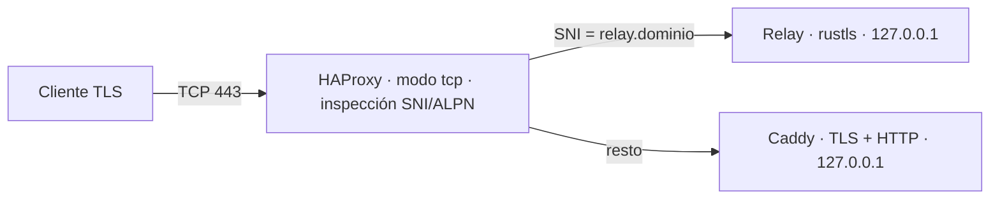

# ADR-004 — Entrada TCP 443 compartida entre panel y relay

- **Estado:** Propuesto (recomendación; pendiente de aceptación)
- **Fecha:** 2026-10-24
- **Debe resolverse antes de:** fase 5
- **Relacionados:** ADR-003 (formato de datagrama)

## Contexto

El servidor principal expone panel/API (HTTPS), relay TLS/TCP y STUN/relay UDP con **una IPv4 y una IPv6** (observado en la inspección de solo lectura). El fallback TLS/TCP existe para redes que solo dejan salir 443; ponerlo en otro puerto anula su motivo. Separar panel y relay solo por nombre DNS no basta: ambos necesitan escuchar en TCP 443 de la misma IP.

## Decisión

**Un único proceso L4 escucha TCP 443 (IPv4 e IPv6) y enruta por SNI sin terminar TLS. Panel y relay escuchan en loopback.**

1. **Enrutador:** HAProxy en `mode tcp` con `tcp-request inspect-delay` y reglas sobre `req.ssl_sni` (y `req.ssl_alpn`). No descifra: no ve claves ni tráfico. Se prefiere un componente maduro de L4 a código propio en la ruta pública.
2. **Regla:** SNI == nombre del relay **y** ALPN `atenea-relay/1` → relay. Cualquier otra cosa (incluido sin SNI) → Caddy, que decide. ClientHello incompleto tras el plazo de inspección → se cierra la conexión.
3. **IP de cliente:** HAProxy envía PROXY protocol v2 a ambos backends. Solo se acepta PROXY desde loopback; el relay lo necesita para limitar por origen y Caddy para sus registros.
4. **Certificados:** Caddy gestiona el del panel con HTTP-01 en TCP 80 (TLS-ALPN-01 necesitaría 443). El relay termina TLS con rustls y su propio certificado para el nombre del relay; **TLS 1.3 como mínimo, sin 0-RTT**. El cliente valida ese certificado contra el nombre del relay configurado en la configuración firmada (hint de endpoint). La confidencialidad e integridad del tráfico de aplicación no dependen de TLS: va cifrado de extremo a extremo (ADR-003).
5. **Framing TCP del relay:** cada trama = `longitud (u16, big-endian)` + cuerpo; el cuerpo contiene un datagrama del formato de ADR-003 con la cabecera de direccionamiento del relay (se define en la fase 5). Longitud máxima 2048; mayor o 0 = cierre de conexión. Lectura con búfer acotado y tolerancia a lecturas parciales.

### Puertos del host

| Puerto | Escucha | Función |
| --- | --- | --- |
| TCP 22 | sshd | Administración existente (no cambia) |
| TCP 80 | Caddy | HTTP-01 y redirección a HTTPS |
| TCP 443 | HAProxy | Panel/API (→ Caddy) y relay TLS (→ relay) |
| UDP 3478 | STUN | Descubrimiento de endpoints |
| UDP 443 | Relay UDP | Retransmisión UDP |
| Loopback | Caddy, relay TLS, control plane, coordinator, PostgreSQL | No expuestos |

El firewall del host es deny por defecto y solo abre los anteriores.

## Alternativas

| Opción | Motivo |
| --- | --- |
| Relay en puerto alternativo (p. ej. 8443) | Redes restringidas bloquean puertos no estándar; el fallback pierde su razón de ser. Vale como puerto adicional, no como sustituto. |
| Relay delante de todo (el relay reenvía lo que no es suyo a Caddy) | Pone código propio y no probado en la ruta de todo el tráfico público, y acopla la disponibilidad del panel al relay. |
| Caddy con el módulo `layer4` | Requiere compilar Caddy con plugin de terceros y concentra panel y entrada en un proceso. Posible, pero HAProxy es más estándar en este papel. |
| IP adicional para el relay | Solución limpia que depende de contratar una IP (y de IPv6 adicional). Queda como mejora; no bloquea el diseño. |
| ALPN `h2`/`http/1.1` disfrazado para el relay | Camuflaje que promete algo que no se puede garantizar; se documenta que la inspección corporativa puede bloquear el fallback. |

## Consecuencias

- Una pieza más de infraestructura (HAProxy) en el camino de 443; si cae, caen panel y relay TLS. La HA de la entrada se trata en la fase 9 (segundo nodo).
- Con PROXY v2 hay que impedir que un cliente externo lo envíe: backends solo en loopback y comprobación de origen.
- Clientes sin SNI correcto no pueden usar el fallback; es intencionado.
- No resuelve proxies HTTP ni inspección TLS que sustituya certificados: se documentan como redes no soportadas.

## Verificación

Fases 5 y 9: desde una red con solo TCP 443 saliente, el agente llega al relay y el navegador al panel simultáneamente; ClientHello fragmentado y lento no agota recursos; SNI desconocido no llega al relay; PROXY v2 forjado desde fuera es ignorado o rechazado; reconexión IPv6; caída de HAProxy/relay/Caddy por separado muestra el aislamiento esperado. Alcanzabilidad externa de UDP 3478/443 y TCP 80/443 en el firewall del proveedor: **sin comprobar**.

## Pendiente del usuario

Dominio del despliegue y nombres (`panel.` y `relay.`): sin ellos no hay SNI ni certificados. Confirmar HAProxy como componente de entrada.
