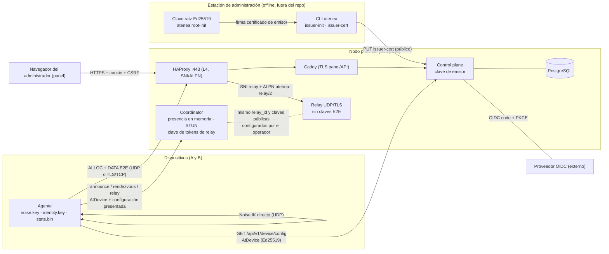
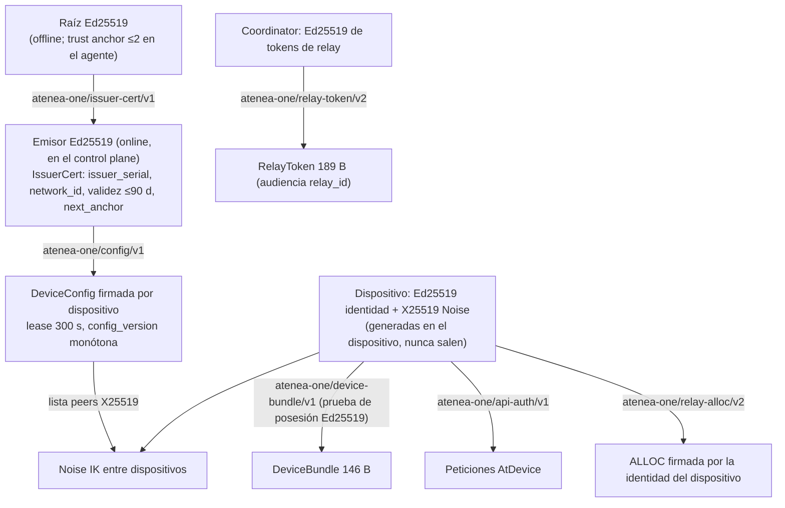
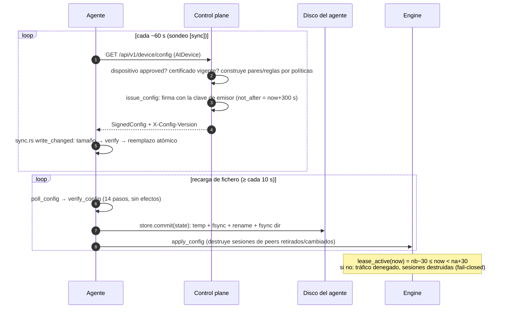

# Arquitectura para auditores

**Referencia de código:** `a0f8ac71b5e83607603c45b46113a2aa0ea607b6` (`git rev-parse HEAD`). Este documento describe ese árbol; los números de línea se refieren a él. **No es una afirmación de seguridad, de auditoría realizada ni de aptitud para producción**: el [README del paquete](README.md) mantiene el estado «no apto para datos sensibles hasta auditoría independiente».

## Convención de evidencia

| Etiqueta | Significado aquí |
| --- | --- |
| **VERIFICADO (lectura)** | El contenido citado se leyó en el fichero enlazado. No demuestra ejecución, corrección ni ausencia de defectos. |
| **PARCIAL** | Hay evidencia, pero no cubre todo el criterio (por ejemplo: contrato leído, implementación o ejecución sin comprobar). |
| **SIN COMPROBAR** | No se leyó ni se ejecutó lo necesario. |
| **INFERIDO** | Deducción del autor a partir de diseño/código; no es medición ni cita literal. |

No se ejecutó ninguna prueba, compilación, fuzz, Docker ni laboratorio al preparar este documento. «VERIFICADO» nunca significa «probado en ejecución».

## 1. Componentes

| Componente | Código | Qué hace | Estado persistente | Secretos que custodia |
| --- | --- | --- | --- | --- |
| **Agente** (`atenea-agent`) | [`apps/agent`](../../apps/agent/src), [`crates/crypto`](../../crates/crypto/src), [`crates/identity`](../../crates/identity/src), [`crates/policies`](../../crates/policies/src), [`crates/tunnel`](../../crates/tunnel/src), [`crates/windows`](../../crates/windows/src) | Dueño de la TUN y de las claves del dispositivo; verifica la configuración firmada, hace Noise IK, aplica ACL, rutas y DNS; IPC local. | `state.bin` (anti-rollback), configuración firmada, ficheros de clave | `noise.key` (X25519), `identity.key` (Ed25519) |
| **CLI** (`atenea`) | [`apps/cli`](../../apps/cli/src) | `root-init`, `issuer-init`, `issuer-cert`, `device-init`, `issue`, `enroll`, `agent-config`, IPC al agente. | Ficheros de clave/certificado que escribe | Semilla raíz y de emisor al generarlas |
| **Control plane** | [`apps/control-plane`](../../apps/control-plane/src), [`docs/api/control-plane-v1.md`](../api/control-plane-v1.md) | Axum + PostgreSQL. OIDC, RBAC, redes, IPAM, enrolamiento, aprobación/revocación, ACL, **emisión de la configuración firmada por petición**. | PostgreSQL (fuente de verdad) | Clave de **emisor**; `DATABASE_URL`; secreto de cliente OIDC |
| **Coordinator** | [`apps/coordinator`](../../apps/coordinator/src), [`crates/nat-traversal`](../../crates/nat-traversal/src), [`coordinator-v1`](../protocol/coordinator-v1.md) | Presencia en memoria, rendezvous, STUN propio, emisión de tokens de relay. No consulta PostgreSQL. | Ninguno duradero | Clave de firma de tokens de relay |
| **Relay** | [`apps/relay`](../../apps/relay/src), [`crates/relay-core`](../../crates/relay-core/src), [`relay-v2`](../protocol/relay-v2.md) | Reenvío UDP y TLS/TCP de datagramas E2E opacos entre asignaciones emparejadas. No tiene claves E2E. | Ninguno duradero | Clave TLS; secreto de cookie (memoria); claves públicas del coordinator |
| **Entrada 443** | [`deploy/compose/prod/haproxy.cfg`](../../deploy/compose/prod/haproxy.cfg), Caddy, [ADR-004](../architecture/ADR-004-entrada-443.md) | HAProxy L4 enruta por SNI/ALPN sin terminar TLS: relay o panel/API. | — | — |
| **Panel** | [`apps/web`](../../apps/web), servido por el control plane (`panel.rs`) | SPA que consume la API; no define modelos propios. | — | Cookie de sesión HttpOnly (la gestiona el navegador) |
| **Par de pruebas** | [`crates/testpeer`](../../crates/testpeer/src) | `Engine` sin TUN para laboratorios/CI. | — | Claves sintéticas |

Estado del contrato de cada pieza: [ADR-001](../architecture/ADR-001-noise-ik.md) a [ADR-005](../architecture/ADR-005-custodia-clave-raiz.md), [ADR-007](../architecture/ADR-007-subredes-dns-privilegios.md), [ADR-008](../architecture/ADR-008-clientes-windows-macos.md) y [ADR-009](../architecture/ADR-009-operacion-y-releases.md) existen y se leyeron (VERIFICADO, lectura). El [índice](../architecture/README.md) solo lista 001–006 y marca 006 (licencia) «Pendiente de ratificar»; **no existe fichero ADR-006** en el árbol (VERIFICADO, listado del directorio). ADR-009 figura «Propuesto» (pendiente de ratificar por el responsable).

## 2. Mapa de componentes y fronteras de confianza



**Fronteras (cada línea del diagrama es una frontera de confianza distinta):**

| # | Frontera | Qué cruza | Autenticación / integridad | Evidencia | Estado |
| --- | --- | --- | --- | --- | --- |
| F1 | Raíz → emisor | Certificado de emisor (178 B) firmado por la raíz | Ed25519 estricto, dominio `atenea-one/issuer-cert/v1\0` | [`signed-config-v1` §2.2](../protocol/signed-config-v1.md), [`identity/src/lib.rs`](../../crates/identity/src/lib.rs) L45 y L69–L77 | VERIFICADO (lectura) |
| F2 | Emisor → agente | `SignedConfig` por dispositivo | Cadena raíz→emisor→configuración; 14 pasos de [verify_config](../../crates/identity/src/verify.rs) L103 | [`signed-config-v1` §3](../protocol/signed-config-v1.md) | VERIFICADO (lectura del contrato y del punto de llamada); ejecución SIN COMPROBAR |
| F3 | Dispositivo → control plane/coordinator | Peticiones HTTP | `Authorization: AtDevice v1` con la clave de identidad; ventana ±60 s, nonce 120 s | [`api_auth.rs`](../../crates/identity/src/api_auth.rs) L51 y L102, [coordinator `auth.rs`](../../apps/coordinator/src/auth.rs) L23 y L53, [control-plane §3.3](../api/control-plane-v1.md) | VERIFICADO (lectura) |
| F4 | Coordinator → relay | Token de 189 B (audiencia = `relay_id`) | Ed25519 del coordinator; el relay acepta 1–32 claves públicas configuradas | [`relay-core`](../../crates/relay-core/src/lib.rs) L37 y L423, [`relay/config.rs`](../../apps/relay/src/config.rs) L124 | VERIFICADO (lectura) |
| F5 | Agente ↔ agente | Datagramas Atenea v2 | Noise IK + MAC1/MAC2 pre-DH + antirreplay; **el relay y el coordinator no son de confianza** | [wire-v2](../protocol/wire-v2.md), [`crypto`](../../crates/crypto/src/lib.rs) | VERIFICADO (lectura); conformidad criptográfica SIN COMPROBAR (revisión externa pendiente según los propios contratos) |
| F6 | Agente ↔ relay | ALLOC/DATA | Cookie UDP ligada al origen o TLS 1.3, token del coordinator, prueba Ed25519 del dispositivo | [`relay/state.rs`](../../apps/relay/src/state.rs) L93–L153 | VERIFICADO (lectura del orden de comprobaciones) |
| F7 | Navegador → control plane | Sesión OIDC | Cookie `atenea_session` (HttpOnly, SameSite=Lax), CSRF en escrituras, WebSocket con `Origin` | [`auth.rs`](../../apps/control-plane/src/auth.rs) L59–L60 y L269–L308, [control-plane §3.1](../api/control-plane-v1.md) | VERIFICADO (lectura parcial: cookie y creación de sesión); validación de ID token completa SIN COMPROBAR aquí |
| F8 | Proceso local → agente | IPC (Unix socket / pipe con nombre) | Modo 0600/0660, `SO_PEERCRED`; en Windows, DACL e impersonación | [ADR-007 §6](../architecture/ADR-007-subredes-dns-privilegios.md), [ADR-008 §4](../architecture/ADR-008-clientes-windows-macos.md), [`ipc.rs`](../../apps/agent/src/ipc.rs) L69, [`security.rs`](../../crates/windows/src/security.rs) | PARCIAL (contratos y fragmentos leídos; revisión completa de plataformas pendiente) |
| F9 | Internet → HAProxy | TCP 443 | Sin terminar TLS; relay solo con SNI = `RELAY_HOST` **y** ALPN `atenea-relay/2` | [`haproxy.cfg`](../../deploy/compose/prod/haproxy.cfg) L12–L24 | VERIFICADO (lectura de la configuración); comportamiento en red real SIN COMPROBAR |

### Qué puede y qué no puede hacer cada pieza si se compromete (INFERIDO de ADR/contratos)

| Pieza comprometida | Puede | No puede (según el diseño) | Fuente |
| --- | --- | --- | --- |
| Relay | Ver metadatos, descartar/retrasar, atribuir DATA a otro par de la misma concesión | Descifrar o autenticar tráfico E2E; elegir destino (solo reenvía entre asignaciones emparejadas) | [relay-v2 §1](../protocol/relay-v2.md), [threat-model](../security/threat-model.md) |
| Coordinator | Mentir sobre candidatos; emitir tokens de relay; ver presencia | Descifrar, suplantar a un par (IK con claves de la configuración firmada) ni modificar ACL | [coordinator-v1 §1 y §6](../protocol/coordinator-v1.md) |
| Control plane / clave de emisor | Autorizar dispositivos y redes hasta que caduque el certificado del emisor | Obtener la raíz ni claves privadas de dispositivo (nunca las recibe) | [ADR-005](../architecture/ADR-005-custodia-clave-raiz.md), [control-plane §1](../api/control-plane-v1.md) |
| Clave raíz | Todo lo anterior y reemitir emisores | — (sin recuperación automática: reincorporar cada dispositivo) | [ADR-005](../architecture/ADR-005-custodia-clave-raiz.md) |
| Dispositivo hostil | Ignorar su propio lease | Obligar a sus peers a aceptarlo tras revocación: su ACL y su lista de peers los fija la configuración de cada peer | [ADR-002](../architecture/ADR-002-revocacion-lease.md) |

## 3. Jerarquía de claves y dominios de firma



| Dominio de firma (con `\0` final) | Firma | Código | Contrato |
| --- | --- | --- | --- |
| `atenea-one/issuer-cert/v1` | Raíz | [`identity/lib.rs` L45](../../crates/identity/src/lib.rs) | [signed-config-v1 §2.2](../protocol/signed-config-v1.md) |
| `atenea-one/config/v1` (también cuerpos v2) | Emisor | [`identity/lib.rs` L46](../../crates/identity/src/lib.rs) | [v1 §2.4](../protocol/signed-config-v1.md), [v2](../protocol/signed-config-v2.md) |
| `atenea-one/device-bundle/v1` | Identidad del dispositivo | [`identity/lib.rs` L47](../../crates/identity/src/lib.rs) | [v1 §2.1](../protocol/signed-config-v1.md) |
| `atenea-one/api-auth/v1` | Identidad del dispositivo | [`api_auth.rs` L51](../../crates/identity/src/api_auth.rs) | [control-plane §3.3](../api/control-plane-v1.md) |
| `atenea-one/relay-token/v2` | Coordinator | [`relay-core` L37](../../crates/relay-core/src/lib.rs) | [relay-v2 §4](../protocol/relay-v2.md) |
| `atenea-one/relay-alloc/v2` | Identidad del dispositivo | [`relay-core` L38](../../crates/relay-core/src/lib.rs) | [relay-v2 §4](../protocol/relay-v2.md) |

Todas las verificaciones Ed25519 localizadas usan `verify_strict` ([`identity/lib.rs` L75](../../crates/identity/src/lib.rs), [`relay-core` L431 y L486](../../crates/relay-core/src/lib.rs)) — VERIFICADO (lectura de esas llamadas; no se auditó la API de `ed25519-dalek` 3.0.0). Lo que protege y lo que no el pinning de anclas: [ADR-005](../architecture/ADR-005-custodia-clave-raiz.md).

## 4. Flujos

### 4.1 Enrolamiento y aprobación

```mermaid
sequenceDiagram
  autonumber
  participant ADM as Administrador (offline + panel)
  participant CP as Control plane
  participant DB as PostgreSQL
  participant OP as Operador del dispositivo
  participant AG as Agente / CLI

  Note over ADM: root-init (raíz offline) · issuer-init · issuer-cert
  ADM->>CP: PUT /networks/{net}/issuer-cert (178 B, público)
  CP->>CP: valida que parsea, red coincide, firma raíz = root_anchor, vigente
  ADM->>CP: POST enrollment-tokens {ttl 60..86400 s, auto_approve}
  CP->>DB: guarda SHA-256(token); token en claro solo en la respuesta
  CP-->>ADM: join = {url, token, network_id, root_anchor}
  ADM-->>OP: join por canal fuera de banda (fija trust_anchor)
  OP->>AG: device-init → noise.key, identity.key (0600), bundle.bin
  OP->>CP: POST /api/v1/enroll {token, bundle, name}
  CP->>DB: UPDATE … consumed_at WHERE hash AND consumed_at IS NULL AND no caducado
  CP->>CP: DeviceBundle.verify() (prueba de posesión Ed25519)
  CP->>DB: INSERT device 'pending' (o 'approved'+IPAM si auto_approve)
  CP-->>OP: 201 {device_id, network_id, status}
  ADM->>ADM: compara la huella del bundle por otro canal
  ADM->>CP: POST …/devices/{dev}/approve
  CP->>DB: transacción: bloqueo de red, IPv4+IPv6 libres más bajas
```

| Paso | Evidencia | Estado |
| --- | --- | --- |
| Generación de claves de dispositivo | CLI [`device_init`](../../apps/cli/src/issue.rs) L195 (`StaticKeypair::generate`, [`crypto` L74](../../crates/crypto/src/lib.rs); semilla Ed25519 con `generate_seed`, [`identity` L49](../../crates/identity/src/lib.rs)); escritura 0600 `create_new` en [`write_secret`](../../apps/cli/src/issue.rs) L32–L39 | VERIFICADO (lectura) |
| Token: 256 bits aleatorios, base64url, solo hash en BD | [`devices.rs`](../../apps/control-plane/src/devices.rs) L30 y L38 | VERIFICADO (lectura) |
| Consumo atómico del token | [`devices.rs` L85](../../apps/control-plane/src/devices.rs) (`UPDATE … RETURNING`) | VERIFICADO (lectura); la prueba de N peticiones concurrentes SIN COMPROBAR (ejecución) |
| Aprobación / IPAM / revocación | [`devices.rs`](../../apps/control-plane/src/devices.rs) L155 (approve), L195 y L207 (revoke), [control-plane §2 y §5](../api/control-plane-v1.md) | VERIFICADO (lectura parcial; bloqueo de red e IPAM leídos solo en el contrato) |
| Rutas HTTP | [`api.rs` L104–L105](../../apps/control-plane/src/api.rs) | VERIFICADO (lectura) |
| El `root_anchor` viaja en `join`, no lo sirve el servicio | [control-plane §5.1](../api/control-plane-v1.md) | VERIFICADO (lectura del contrato) |

Riesgos de diseño documentados: la `proof` del bundle no prueba posesión de la clave X25519; el enlace real es la comparación de huella por otro canal ([signed-config-v1 §7](../protocol/signed-config-v1.md)); el enrolamiento no tiene verificación automática (MVP).

### 4.2 Emisión, verificación y lease de configuración



| Aspecto | Evidencia | Estado |
| --- | --- | --- |
| Emisión por petición, solo `approved`; no registra la clave raíz | [`issue.rs`](../../apps/control-plane/src/issue.rs) L141 (get), L178–L189 (`device_not_approved`), L269 (`issue_config`) | VERIFICADO (lectura) |
| Clave de emisor: fichero regular 0400/0600, `symlink_metadata`, semilla en memoria con `zeroize` | [`main.rs`](../../apps/control-plane/src/main.rs) L37–L50 y L97–L99 | VERIFICADO (lectura) |
| Verificación sin efectos y persistencia **antes** de aplicar | [`run.rs`](../../apps/agent/src/run.rs) L176–L259 (`verify_config` → `store.commit` → `apply`) | VERIFICADO (lectura) |
| Sincronización: valida y verifica **antes** de reemplazar el fichero | [`sync.rs`](../../apps/agent/src/sync.rs) L73–L90 | VERIFICADO (lectura) |
| Persistencia atómica de estado (0600/0700, rename+fsync) | [`state.rs`](../../apps/agent/src/state.rs) L27 y L63, [`private_files.rs`](../../apps/agent/src/platform/private_files.rs) L74–L100 | VERIFICADO (lectura parcial) |
| Lease y tolerancia (30 s) | [`engine.rs` L739](../../apps/agent/src/engine.rs); [`CLOCK_TOLERANCE_SECS`](../../crates/identity/src/lib.rs) L44 | VERIFICADO (lectura) |
| Anti-rollback de versión, serial y reloj | Pasos 7, 11 y 13: [`verify.rs`](../../crates/identity/src/verify.rs) L69, L130, L134–L135; [ADR-002](../architecture/ADR-002-revocacion-lease.md) | VERIFICADO (lectura de los errores); casos de reloj/corte de energía SIN COMPROBAR (ejecución) |
| Rechazo de una configuración no revoca la vigente | [`run.rs` L175](../../apps/agent/src/run.rs) | VERIFICADO (lectura) |

Límites asumidos por diseño: el fichero de estado no está autenticado; quien escriba en el directorio de estado (root local) puede retrocederlo ([signed-config-v1 §8](../protocol/signed-config-v1.md)). La corrupción deniega y exige reinicialización explícita ([`state.rs` L12](../../apps/agent/src/state.rs)). Los reloj/NTP forman parte de la seguridad ([ADR-002](../architecture/ADR-002-revocacion-lease.md)).

### 4.3 Revocación

Revocar = dejar de emitir (lease), no un canal en vivo.

```mermaid
sequenceDiagram
  autonumber
  participant ADM as Administrador
  participant CP as Control plane
  participant P as Peers de D (agentes)
  participant D as Agente D (revocado)
  participant CO as Coordinator

  ADM->>CP: POST …/devices/{D}/revoke
  CP->>CP: UPDATE devices SET status='revoked' (idempotente); libera IPs; auditoría
  Note over CP: GET device/config de D → 403 device_not_approved<br/>y D desaparece de la configuración de sus peers en la siguiente emisión
  P->>CP: siguiente sondeo (≤ ~60 s)
  CP-->>P: configuración sin D
  P->>P: apply_config: destruye sesión con D, rechaza nuevos handshakes de D
  D->>D: sin renovación: lease expira (≤ 300+30 s) → fail-closed
  D--xCO: su presencia caduca con su configuración (≤ not_after+30)
```

| Límite temporal (ADR-002, parámetros del piloto) | Valor |
| --- | --- |
| Validez de configuración / cadencia de reemisión / tolerancia | 300 s / 60 s / 30 s |
| Peers honestos que alcanzan al emisor | ≤ 60 s + tiempo de recarga |
| Peor caso para peers aislados y para el propio agente de D | ≤ 330 s |
| Emisor caído más de ~5 min | **todos los túneles caen** (fail-closed por diseño) |

Evidencia: [ADR-002](../architecture/ADR-002-revocacion-lease.md) (decisión), [control-plane §6](../api/control-plane-v1.md) («Revocación»), [`devices.rs` L207](../../apps/control-plane/src/devices.rs) (la sentencia `UPDATE … status='revoked'`), [`engine.rs` L686](../../apps/agent/src/engine.rs) (`apply_config`). Estado: lógica VERIFICADO (lectura); latencias medidas en [caídas y leases](../operations/caidas-y-leases.md) y E2E de fase 3B — PARCIAL (documentadas, no repetidas aquí; el [índice de evidencia](evidencia.md) las atribuye). Un dispositivo hostil puede ignorar su lease: lo contiene la configuración de sus peers.

### 4.4 Handshake Noise IK, MAC1/MAC2 y cookie

```mermaid
sequenceDiagram
  autonumber
  participant I as Iniciador
  participant W as Camino (UDP directo, relay UDP o TLS)
  participant R as Respondedor

  I->>R: INIT 146 B = v2 ‖ tipo ‖ idx ‖ noise_msg1[108] ‖ MAC1 ‖ MAC2
  Note over R: 1 versión/tipo/longitud exacta<br/>2 verify_mac1 (clave pública derivada de la estática del respondedor): si falla, descarte silencioso<br/>3 contar INIT con MAC1 válido por ventana de 1 s
  alt umbral (100/s por defecto) superado y MAC2 ausente/ inválido
    R-->>I: COOKIE_REPLY 62 B (XChaCha20Poly1305; AAD = cabecera‖MAC1) — sin DH ni sesión
    I->>R: mismo INIT (mismo Noise/índice) con MAC2 = BLAKE2s-keyed16(cookie, INIT[0..130])
  end
  Note over R: 4 cuotas pre-DH (por par; por IP/IPv6 /64 y global para desconocidos)<br/>5 DH Noise · clave estática autorizada en la configuración · lease · red/prólogo · timestamp ±30 s y > último
  R-->>I: RESP 62 B (noise_msg2)
  I->>R: DATA con contador explícito (nonce AEAD) — confirma sesión y endpoint
  Note over I,R: El endpoint solo se confirma con RESP o DATA autenticados (nunca INIT ni COOKIE_REPLY)
```

| Elemento | Dónde está en el código | Estado |
| --- | --- | --- |
| Patrón `Noise_IK_25519_ChaChaPoly_BLAKE2s`, prólogo `atenea-one/v2 ‖ network_id`, `StatelessTransportState` | [`crypto/lib.rs`](../../crates/crypto/src/lib.rs) L18, L23–L24, L98, L200, L269 | VERIFICADO (lectura) |
| Orden pre-DH puro (parseo → MAC1 → contar → MAC2) | [`cookie.rs` `pre_dh`](../../crates/crypto/src/cookie.rs) L243–L259 | VERIFICADO (lectura) |
| MAC1 y claves (`k_mac1`, `k_reply`) | [`cookie.rs`](../../crates/crypto/src/cookie.rs) L117–L122, L140 | VERIFICADO (lectura) |
| MAC de 16 B en modo *keyed* (no truncado) | `Blake2sMac<U16>` en [`cookie.rs`](../../crates/crypto/src/cookie.rs) L27 y L100–L108 | VERIFICADO (lectura); corrección frente al contrato SIN COMPROBAR (pregunta 1 del [alcance](alcance-y-preguntas.md)) |
| Secreto de cookie: `getrandom`, rotación 120 s, anterior solo un período, `Zeroizing` | [`cookie.rs`](../../crates/crypto/src/cookie.rs) L25, L149–L187 | VERIFICADO (lectura) |
| Respuesta de cookie (XChaCha20Poly1305, nonce aleatorio por emisión; fallo del RNG → no emite) | [`cookie.rs`](../../crates/crypto/src/cookie.rs) L263–L300 y L303–L330 | VERIFICADO (lectura parcial) |
| Uso en el motor (descarte, desafío, cola de reintento, frescura) | [`engine.rs`](../../apps/agent/src/engine.rs) L1029–L1087 (pre-DH y respuesta), L1171 (`open_reply`), L1228 (`check_timestamp`) | VERIFICADO (lectura de los puntos de llamada) |
| Vectores publicados en el contrato | [wire-v2 §7](../protocol/wire-v2.md), [`vectors.rs`](../../crates/crypto/src/cookie/vectors.rs), [`tests.rs`](../../crates/crypto/src/cookie/tests.rs) | PARCIAL (existen; su ejecución no se repitió; el origen Python de los vectores no está versionado según [evidencia](evidencia.md)) |

Límites reconocidos por los propios contratos: MAC1 y la clave de respuesta son derivables por quien conozca la clave pública del respondedor (no autentican); la cookie no sustituye a Noise ni garantiza disponibilidad; v1 se descarta sin compatibilidad; el roaming de sesiones establecidas actualiza el endpoint con datos autenticados sin desafío de retorno (riesgo aceptado por el responsable, [ADR-003](../architecture/ADR-003-cifrado-antirreplay.md)).

### 4.5 Plano de datos: antirreplay, rekey y nonce

| Regla | Código | Estado |
| --- | --- | --- |
| Orden comprobar ventana → autenticar → actualizar ventana (2048 contadores) | [`Session::decrypt`](../../crates/crypto/src/lib.rs) L367–L393; [`replay.rs`](../../crates/crypto/src/replay.rs) L6–L44 | VERIFICADO (lectura) |
| Contador de envío por sesión, consumido antes de cifrar; límite duro 180 s o 2^40 mensajes | [`Session::encrypt`](../../crates/crypto/src/lib.rs) L343–L363 y constantes L26–L31 | VERIFICADO (lectura) |
| Rekey suave = nuevo handshake (120 s o 2^32 mensajes); respondedor no envía hasta confirmar | `should_rekey` L332, `NotConfirmed` L344; uso en [`engine.rs` L1654](../../apps/agent/src/engine.rs) | VERIFICADO (lectura) |
| ACL en origen y destino con deny por defecto; sin tránsito entre pares | [`policies/lib.rs`](../../crates/policies/src/lib.rs) L118–L150, [signed-config-v2 §4](../protocol/signed-config-v2.md) | VERIFICADO (lectura de `Policy::allows`); aplicación en el motor PARCIAL |
| Cabecera de datos sin AEAD adicional (límite de `snow` documentado en ADR-003) | [ADR-003](../architecture/ADR-003-cifrado-antirreplay.md) | VERIFICADO (lectura del ADR) |

La unicidad de nonce ante clonación de VM/snapshot y reinicio es un riesgo reconocido ([ADR-003 «Reinicio y clonación»](../architecture/ADR-003-cifrado-antirreplay.md)); no hay prueba formal (según la matriz). SIN COMPROBAR (independiente).

### 4.6 Relay: concesión, ALLOC y reenvío

```mermaid
sequenceDiagram
  autonumber
  participant A as Agente A
  participant CO as Coordinator
  participant HAP as HAProxy
  participant RL as Relay
  participant B as Agente B

  A->>CO: POST /v1/relay {peer:B} (AtDevice)
  CO->>CO: autorización mutua con ambas presencias; límites por par/dispositivo
  CO-->>A: por relay: {relay_id, udp, tls, token A→B (189 B)}  (sin token raíz)
  CO-->>B: evento kind=relay con tokens B→A, uno por relay_id
  alt UDP
    A->>RL: COOKIE_REQ → COOKIE (BLAKE2s-256(secret‖relay_id‖ip‖puerto‖minuto)[0..16])
  else TLS/TCP
    A->>HAP: ClientHello (SNI relay, ALPN atenea-relay/2)
    HAP->>RL: PROXY v2 (solo loopback) y TLS 1.3 terminado en el relay
  end
  A->>RL: ALLOC {relay_id, cookie, ts, token, firma(identidad A)}
  RL->>RL: cookie → cuota por origen → parse token → audiencia (3 IDs) → firma coordinator → ts ±30 s → prueba Ed25519 → src≠dst → capacidad
  RL-->>A: ALLOC_OK (alloc_id aleatorio) · PEER_STATE
  A->>RL: DATA{alloc_id, datagrama v2 E2E opaco}
  RL->>B: reenvío solo a la asignación emparejada (net,dst,src)
```

| Elemento | Evidencia | Estado |
| --- | --- | --- |
| Emisión de 2×R tokens, ≤4 relays, límites | [`coordinator/lib.rs`](../../apps/coordinator/src/lib.rs) L359–L441 (L128–L131 cuotas; L397 `RelayToken::issue`) | VERIFICADO (lectura) |
| Orden de validaciones del ALLOC | [`relay/state.rs` L93–L138](../../apps/relay/src/state.rs) | VERIFICADO (lectura); coincide con [relay-v2 §4](../protocol/relay-v2.md) |
| Cookie del relay (≠ cookie E2E): `CookieMaker`, bucket de 60 s actual/previo, comparación en tiempo constante (`subtle`) | [`relay-core`](../../crates/relay-core/src/lib.rs) L498–L542 y L606 | VERIFICADO (lectura) |
| Secreto de cookie del relay: 32 B `OsRng` por proceso | [`relay/lib.rs` L195–L196](../../apps/relay/src/lib.rs) | VERIFICADO (lectura) |
| TLS 1.3 sin 0-RTT, PEM de certificado y clave | [`relay/tcp.rs` L30–L38](../../apps/relay/src/tcp.rs) | VERIFICADO (lectura parcial; no se leyó la desactivación explícita de 0-RTT) |
| PROXY v2 aceptado solo desde loopback | [`relay/tcp.rs` L45–L48](../../apps/relay/src/tcp.rs) | VERIFICADO (lectura) |
| Cliente: grants por audiencia, ≤4 relays, sin reutilizar token | [`agent/relay.rs`](../../apps/agent/src/relay.rs) L237 y L403–L420, [`coord.rs`](../../apps/agent/src/coord.rs) L243 | VERIFICADO (lectura parcial) |

Repetición de ALLOC: tolerada **dentro de la misma audiencia** y ventana de ±30 s; la audiencia solo elimina la reutilización entre `relay_id` distintos ([relay-v2 §4](../protocol/relay-v2.md)). Dos procesos con el mismo `relay_id` son una única audiencia.

### 4.7 Entrada pública 443

HAProxy en modo `tcp` inspecciona SNI/ALPN sin descifrar: `relay` solo si SNI = `RELAY_HOST` **y** ALPN `atenea-relay/2`; el resto va a Caddy (panel). Lo leído en [`haproxy.cfg`](../../deploy/compose/prod/haproxy.cfg) L12–L24 coincide con [ADR-004](../architecture/ADR-004-entrada-443.md) salvo un detalle: el backend `panel` también recibe PROXY v2 (`send-proxy-v2 check-send-proxy`, L24), mientras que el texto de ADR-004 §3 describe la versión de la fase 5 (PROXY solo al relay) — VERIFICADO (lectura); el ADR deja esa evolución prevista para la fase 9. Alcanzabilidad externa de UDP 3478/443 y TCP 80/443 en el proveedor: **SIN COMPROBAR** (así lo declara el propio ADR-004).

## 5. Inventario de secretos

Convención: «generación» = quién crea el valor; «lectores» = código que lo consume en ejecución. Ningún valor real se incluye en el repositorio (los ejemplos son sintéticos). «Rotación» describe lo que el diseño/código permite, no lo ensayado.

| Secreto | Generación | Almacenamiento y permisos | Rotación | Lectores | Evidencia | Estado |
| --- | --- | --- | --- | --- | --- | --- |
| **Clave raíz Ed25519** (semilla de 32 B en hex) | `atenea root-init` → [`root_init`](../../apps/cli/src/issue.rs) L106 → `generate_seed` ([`identity` L49](../../crates/identity/src/lib.rs), `getrandom`) | Fichero 0600 `create_new` ([`write_secret` L32–L39](../../apps/cli/src/issue.rs)). ADR-005 exige estación de administración y copias cifradas con `age`; el CLI **escribe la semilla en claro con modo 0600** | Hasta 2 anclas; `next_anchor` firmado por la raíz en el certificado. Pérdida/compromiso: reincorporar cada dispositivo | `issuer-init`, `issuer-cert` ([`read_seed` L73](../../apps/cli/src/issue.rs), exige 0600) | [ADR-005](../architecture/ADR-005-custodia-clave-raiz.md), [signed-config-v1 §3 y §7](../protocol/signed-config-v1.md) | Generación/permisos VERIFICADO (lectura); cifrado `age`, custodia offline y token hardware: **SIN COMPROBAR** (procedimiento operativo; token pendiente según ADR-005) |
| **Clave de emisor Ed25519** | `atenea issuer-init` ([`issuer_init` L116](../../apps/cli/src/issue.rs)) con certificado firmado por la raíz | Fichero hex; el control plane exige regular y 0400/0600 y rechaza symlinks ([`main.rs` L37–L50](../../apps/control-plane/src/main.rs)) | Certificado con `issuer_serial` mayor; validez ≤90 d (v1) / 30 d lab (ADR-005); el agente rechaza serial menor | Control plane ([`issue.rs` L269](../../apps/control-plane/src/issue.rs)); copia de seguridad cifrada con `age` ([`keys-backup.sh`](../../deploy/backup/keys-backup.sh) L22) | idem | VERIFICADO (lectura); rotación en producción SIN COMPROBAR (ensayo parcial según [matriz](../operations/matriz-de-aceptacion.md)) |
| **`noise.key` (X25519) e `identity.key` (Ed25519)** | `atenea device-init` ([`device_init` L195](../../apps/cli/src/issue.rs)): `StaticKeypair::generate` / `generate_seed` | 0600. El agente rechaza symlink, no regular, modo con bits de grupo/otros y propietario inesperado ([`private_files.rs` L14–L43](../../apps/agent/src/platform/private_files.rs)); Windows: DACL SYSTEM/Administrators ([`read_private`](../../crates/windows/src/security.rs) L223); `credential:<nombre>` vía `CREDENTIALS_DIRECTORY` ([`config.rs` L245–L276](../../apps/agent/src/config.rs)) | Sin rotación en caliente: cambio de clave = nuevo bundle y nueva configuración firmada ([ADR-001 §6](../architecture/ADR-001-noise-ik.md)) | Agente únicamente (`load_noise_key`, `load_identity_key`, [`config.rs` L278–L284](../../apps/agent/src/config.rs)); par de pruebas ([`testpeer/main.rs` L49](../../crates/testpeer/src/main.rs)) | [ADR-005 «Consecuencias»](../architecture/ADR-005-custodia-clave-raiz.md), [ADR-007 §7](../architecture/ADR-007-subredes-dns-privilegios.md) | VERIFICADO (lectura Unix y firmas de Windows); comportamiento real en Windows/macOS SIN COMPROBAR aquí |
| **`state.bin`** (no secreto; integridad crítica: serial, versión, anclas, hora máxima) | El agente tras verificar una configuración | 0600 en directorio 0700, reemplazo atómico ([`state.rs` L27](../../apps/agent/src/state.rs)). **Sin autenticación** de contenido | `reset_clock` conserva versión/serial/anclas ([`state.rs` L99](../../apps/agent/src/state.rs)) | Agente | [signed-config-v1 §8](../protocol/signed-config-v1.md) | VERIFICADO (lectura); límite conocido: root local puede retroceder el estado |
| **Token de enrolamiento** | Control plane: 32 B aleatorios, base64url ([`devices.rs` L30](../../apps/control-plane/src/devices.rs)) | Solo SHA-256 en BD; en claro únicamente en la respuesta de creación (`Cache-Control: no-store`) | Un uso; TTL 60–86400 s | Control plane en `enroll` ([L85](../../apps/control-plane/src/devices.rs)); operador | [control-plane §4–§5](../api/control-plane-v1.md) | VERIFICADO (lectura) |
| **Sesión de panel y CSRF** | `CsrfToken::new_random_len(32)` ×2 ([`auth.rs` L269–L270](../../apps/control-plane/src/auth.rs)) | Cookie `atenea_session` HttpOnly, SameSite=Lax (L59–L60); en BD, hash SHA-256 del token y del CSRF; **`csrf_token` también en claro** en `sessions` ([L299–L305](../../apps/control-plane/src/auth.rs)) | Renovación y rotación al nuevo login (L290–L296); 8 h absolutas, 1 h inactividad | Control plane | [control-plane §3.1 y «Resoluciones»](../api/control-plane-v1.md) | VERIFICADO (lectura); el CSRF en claro está documentado como decisión |
| **Flujo OIDC** (`state`, verificador PKCE, `nonce`) | `PkceCodeChallenge::new_random_sha256` ([`auth.rs` L163](../../apps/control-plane/src/auth.rs)) | Tabla `oidc_flows` con **verificador PKCE y nonce en claro**, hash del `state`; caduca a 10 min y se consume una vez ([L111–L115, L214](../../apps/control-plane/src/auth.rs)) | Por flujo | Control plane | [control-plane §3.1](../api/control-plane-v1.md) | VERIFICADO (lectura) |
| **`ATENEA_CP_DATABASE_URL`** (credenciales de BD) y **secreto de cliente OIDC** | Operador | Variable o `…_FILE` ([`config.rs` L58–L65](../../apps/control-plane/src/config.rs)); **sin comprobación de permisos del fichero** en el código (a diferencia de las claves) | Operador | Control plane | [ADR-009 §4](../architecture/ADR-009-operacion-y-releases.md) (ficheros montados 0400) | VERIFICADO (lectura de la ausencia de comprobación); permisos efectivos en despliegue SIN COMPROBAR |
| **Clave de firma de tokens de relay** (Ed25519, hex) | Operador (`--print-relay-key` imprime la pública) | 0400/0600 regular ([`coordinator/config.rs` L191–L214](../../apps/coordinator/src/config.rs)) | El relay acepta de 1 a 32 claves públicas (`coordinator_keys`, [`relay/config.rs` L124](../../apps/relay/src/config.rs)): permite solapar | Coordinator ([`lib.rs` L120 y L397](../../apps/coordinator/src/lib.rs)) | [coordinator-v1 §10](../protocol/coordinator-v1.md) | VERIFICADO (lectura) |
| **Clave TLS del relay** (PEM) | Operador (el bootstrap de producción usa `openssl`) | Leída por ruta ([`relay/tcp.rs` L30–L35](../../apps/relay/src/tcp.rs)); **sin comprobación de permisos en el código**; el bootstrap fija 0400 y propietario 65532 ([`bootstrap.py` L60–L61](../../deploy/compose/prod/bootstrap.py)) | Operador (sin automatización localizada) | Relay | [ADR-004](../architecture/ADR-004-entrada-443.md) | VERIFICADO (lectura); rotación SIN COMPROBAR |
| **Secreto de cookie del relay** | `OsRng` 32 B al arrancar ([`relay/lib.rs` L195](../../apps/relay/src/lib.rs)) | Memoria; `Zeroizing` en `CookieMaker` ([`relay-core` L498](../../crates/relay-core/src/lib.rs)) | Cubo de 60 s (actual y anterior); reinicio lo cambia | Relay | [relay-v2 §3](../protocol/relay-v2.md) | VERIFICADO (lectura) |
| **Secreto de cookie E2E** | `getrandom` ([`cookie.rs` L156–L157](../../crates/crypto/src/cookie.rs)) | Memoria, `Zeroizing`; no se persiste ni registra | Cada 120 s; se conserva solo el anterior; reinicio invalida | Agente (respondedor) | [wire-v2 §3](../protocol/wire-v2.md) | VERIFICADO (lectura) |
| **Claves de sesión Noise y contadores** | Handshake (efímeras frescas, `snow`) | Solo memoria; sin persistencia | Rekey 120 s / límite duro 180 s | Agente | [ADR-003](../architecture/ADR-003-cifrado-antirreplay.md) | VERIFICADO (lectura); borrado de memoria por `snow` SIN COMPROBAR |
| **Copia cifrada de claves** (`issuer.key`, `relay-signing.hex`, `application.key`, `oidc-client-secret`) | Operador | Archivo `age` con destinatarios ([`keys-backup.sh`](../../deploy/backup/keys-backup.sh) L18–L23); lista cerrada, sin raíz ([`keys-restore.sh` L11](../../deploy/backup/keys-restore.sh)) | Operador | Operador (identidad `age` offline) | [ADR-009 §3–§4](../architecture/ADR-009-operacion-y-releases.md) | VERIFICADO (lectura de scripts); custodia de la identidad `age` y restauración real: SIN COMPROBAR |

Elementos que **no** son secretos pero conviene no confundir: `relay_id` (128 bits aleatorios, estable, no secreto; [relay-v2 §2](../protocol/relay-v2.md)), `network_id`, `device_id`, claves públicas, `alloc_id` y `token_id`.

Los registros no deben contener tokens, claves ni cuerpos de configuración ([signed-config-v1 §4](../protocol/signed-config-v1.md), [ADR-009 §5](../architecture/ADR-009-operacion-y-releases.md)); la comprobación automática de esa propiedad **no se revisó** aquí (SIN COMPROBAR).

## 6. Primitivas y bibliotecas (versiones de `Cargo.lock`)

Versiones tomadas de [`Cargo.lock`](../../Cargo.lock) del HEAD. Varias bibliotecas aparecen en **más de una versión** porque `snow` y otros crates arrastran las suyas; la tabla indica cuál consume el código propio.

| Primitiva / función | Biblioteca y versión (`Cargo.lock`) | Uso en el código propio | Estado |
| --- | --- | --- | --- |
| Noise `Noise_IK_25519_ChaChaPoly_BLAKE2s`, `StatelessTransportState` | `snow` 0.10.0 (arrastra `blake2` 0.10.6, `chacha20poly1305` 0.10.1, `curve25519-dalek` 4.1.3, `sha2` 0.10.9, `aes-gcm`, `ring` 0.17.14) | [`crypto/lib.rs`](../../crates/crypto/src/lib.rs) L18, L23, L75, L105–L122, L200, L269 | VERIFICADO (lectura). Qué *resolver* de `snow` ejecuta realmente cada operación (RustCrypto vs `ring`) **no se determinó**: INFERIDO que depende de las características de `snow` |
| X25519 (derivación de pública desde privada) | `x25519-dalek` 3.0.0 + `curve25519-dalek` 5.0.0 | [`crypto/lib.rs` L83–L86](../../crates/crypto/src/lib.rs) (`from_private`) | VERIFICADO (lectura) |
| BLAKE2s-256 (hash) y BLAKE2s **keyed, digest 16 B** (MAC1, MAC2, cookie) | `blake2` 0.11.0 | [`cookie.rs`](../../crates/crypto/src/cookie.rs) L10–L27, L100–L122; `key_id`/hash en [`identity/lib.rs` L57–L60](../../crates/identity/src/lib.rs) | VERIFICADO (lectura) |
| XChaCha20Poly1305 (respuesta de cookie) | `chacha20poly1305` 0.10.1 | [`cookie.rs`](../../crates/crypto/src/cookie.rs) L14–L17, L293, L323 | VERIFICADO (lectura) |
| Ed25519 estricto (certificados, configuración, bundle, peticiones, tokens, ALLOC) | `ed25519-dalek` 3.0.0 (con `ed25519` 3.0.0, `signature` 3.0.0); también existe 2.2.0 transitiva | [`identity/lib.rs` L54–L77](../../crates/identity/src/lib.rs), [`relay-core` L423–L490](../../crates/relay-core/src/lib.rs) | VERIFICADO (lectura) |
| Cookie de asignación del relay: BLAKE2s-256 sobre `secret ‖ relay_id ‖ ip ‖ puerto ‖ minuto` | `blake2` 0.11.0 | [`relay-core` L498–L542](../../crates/relay-core/src/lib.rs) | VERIFICADO (lectura) |
| Comparación en tiempo constante | `subtle` 2.6.1 (relay-core, [L606](../../crates/relay-core/src/lib.rs)); verificación de MAC por `blake2` `verify_slice` ([`cookie.rs` L142](../../crates/crypto/src/cookie.rs)) | idem | VERIFICADO (lectura) |
| Aleatoriedad | `getrandom` 0.3.4 (crypto, identity); `rand` 0.8.8 `OsRng` (relay); `rand_core`/`getrandom` adicionales transitivos | [`crypto/lib.rs` L10–L14](../../crates/crypto/src/lib.rs), [`cookie.rs` L157, L269](../../crates/crypto/src/cookie.rs), [`identity/lib.rs` L49–L53](../../crates/identity/src/lib.rs), [`relay/alloc.rs` L85](../../apps/relay/src/alloc.rs), [`relay/lib.rs` L196](../../apps/relay/src/lib.rs) | VERIFICADO (lectura) |
| Borrado de secretos | `zeroize` 1.9.1 | `Zeroizing` en claves/cookies ([`cookie.rs`](../../crates/crypto/src/cookie.rs), [`relay-core`](../../crates/relay-core/src/lib.rs)), lectura de claves del agente ([`private_files.rs` L53](../../apps/agent/src/platform/private_files.rs)) | VERIFICADO (lectura); el borrado no cubre copias de `snow` ni del heap de otras bibliotecas |
| TLS del relay y del agente | `rustls` 0.23.46 (característica `ring`), `tokio-rustls` 0.26.6, `rustls-webpki` 0.103.16, `ring` 0.17.14; `webpki-roots` 1.0.11 (agente) | [`relay/tcp.rs` L36–L38](../../apps/relay/src/tcp.rs) (solo TLS 1.3), [`agent/relay.rs` L193](../../apps/agent/src/relay.rs) (almacén de raíces) | VERIFICADO (lectura) |
| Cliente HTTP del agente/CLI | `ureq` 3.5.0 (rustls) | [`agent/sync.rs`](../../apps/agent/src/sync.rs), [`coord.rs`](../../apps/agent/src/coord.rs), [`cli/enroll.rs`](../../apps/cli/src/enroll.rs) | VERIFICADO (lectura de la dependencia declarada) |
| OIDC (verificación de ID token) | `openidconnect` 4.0.1, `oauth2` 5.0.0, `reqwest` 0.12.28 (rustls), `rsa` 0.9.10 | [`control-plane/auth.rs`](../../apps/control-plane/src/auth.rs) L8–L14, L163–L270 | VERIFICADO (lectura). `cargo-deny` mantiene dos excepciones temporales (RUSTSEC-2026-0387, RUSTSEC-2023-0071) a revisar **antes de 2027-01-23**: [`deny.toml`](../../deny.toml) |
| Hash de sesiones/tokens/configuración | `sha2` 0.10.9 (control plane) | [`auth.rs` L24](../../apps/control-plane/src/auth.rs), [`devices.rs` L38](../../apps/control-plane/src/devices.rs), [`issue.rs` L270](../../apps/control-plane/src/issue.rs) | VERIFICADO (lectura) |
| Base de datos | `sqlx` 0.8.6 (Postgres) | [`control-plane`](../../apps/control-plane/src) | VERIFICADO (lectura de la dependencia) |
| HTTP/servidor | `axum` 0.8.9, `tower` 0.5.3, `tokio` 1.54.1 | apps/coordinator, control-plane, relay | VERIFICADO (lectura de la dependencia) |
| TUN / FFI de plataforma | `libc` 0.2.191 (Linux/macOS), `libloading` 0.8.9 + `windows-sys` 0.61.2 (Windows), `windows-service` 0.8.0 | [`crates/tunnel`](../../crates/tunnel/src), [`crates/windows`](../../crates/windows/src); inventario de `unsafe` en el [mapa](mapa-del-codigo.md#5-inventario-de-bloques-unsafe) | VERIFICADO (lectura) |
| Wintun (DLL de terceros) | No es un crate: Wintun 0.14.1; el instalador valida SHA-256 y firma; no se versiona la DLL | [ADR-008 §4](../architecture/ADR-008-clientes-windows-macos.md) | PARCIAL: contrato leído; comprobación del instalador SIN COMPROBAR |

El inventario completo de dependencias, licencias y excepciones está en [`dependencies.md`](../architecture/dependencies.md) y en `AUDIT-DEPENDENCIES.json` que genera el [snapshot](README.md#snapshot-sin-red-y-verificación) (sin SBOM de pnpm ni de plataformas).

## 7. Divergencias y puntos que el auditor debe contrastar

Observaciones surgidas al leer documentación y código; no son hallazgos de seguridad confirmados.

1. **Estado «pendiente de implementación» obsoleto.** [ADR-001](../architecture/ADR-001-noise-ik.md), [ADR-003](../architecture/ADR-003-cifrado-antirreplay.md), [wire-v2](../protocol/wire-v2.md) y [relay-v2](../protocol/relay-v2.md) declaran cable v2/relay-v2 «pendiente de implementación», pero el código ya contiene prólogo v2, MAC1/MAC2, cookie y vectores (`cookie.rs`, `relay-core`). Además la descripción de [`crates/protocol/Cargo.toml`](../../crates/protocol/Cargo.toml) L9 sigue diciendo «Formato de datagrama v1» e [`identity`](../../crates/identity/Cargo.toml) «Configuración firmada v1». Cotejar contrato frente a código, no frente a la redacción (VERIFICADO, lectura).
2. **Raíz de confianza: contrato vs herramienta.** ADR-005 pide custodia offline y copias cifradas; `atenea root-init` escribe la semilla en claro con 0600. Lo operativo (cifrado, estación aislada) no se puede deducir del repositorio (SIN COMPROBAR).
3. **Comprobaciones de permisos desiguales.** El agente, el emisor del control plane y la clave de firma del coordinator validan modo/tipo; la clave TLS del relay, `DATABASE_URL_FILE` y el secreto OIDC por fichero **no** tienen esa comprobación en el código (el despliegue de producción fija 0400 para la clave del relay). Evaluar si debe ser un control del software o solo del despliegue.
4. **Datos de sesión/OIDC en claro en BD.** `csrf_token`, `pkce_verifier` y `nonce` se guardan sin hash (decisión documentada; acotada por TTL).
5. **PROXY v2 hacia el panel.** La configuración de producción lo envía también a Caddy; ADR-004 §3 describe la variante anterior (ver §4.7).
6. **ADR-006 inexistente y ADR-009 «Propuesto».** Las decisiones de operación/releases no están ratificadas formalmente.
7. **Estado del agente sin autenticación de contenido** (conocido): protege la corrupción, no a un root local.
8. **`unsafe`:** véase [mapa del código §5](mapa-del-codigo.md#5-inventario-de-bloques-unsafe); `crates/windows` aplica `#[allow(unsafe_code)]` a `mod service` aunque `service.rs` no contiene la palabra `unsafe`.
9. **Wintun cargado por ruta configurable.** `ATENEA_WINTUN_DLL` (absoluta) o `wintun.dll` junto al ejecutable ([`tunnel/windows.rs` L83–L99](../../crates/tunnel/src/windows.rs)); el código no verifica hash ni firma de la DLL (eso recae en el instalador). Los permisos del directorio de instalación: SIN COMPROBAR.

## 8. Alcance y límites de este documento

- Lectura estática del árbol `a0f8ac7`; sin compilar, ejecutar pruebas, fuzz, laboratorios ni Docker.
- Los números de línea son del HEAD indicado; cualquier cambio posterior los desplaza.
- «VERIFICADO (lectura)» de un contrato no implica conformidad del código, y la conformidad del código no implica seguridad; no se revisó `snow`, `ring` ni otras dependencias.
- Infraestructura real (DNS, ACME, firewall del proveedor, UDP/TCP 443 alcanzables), instaladores firmados y máquinas físicas Windows/macOS: SIN COMPROBAR. Véase [evidencia y brechas](evidencia.md) y la [matriz de aceptación](../operations/matriz-de-aceptacion.md).
- Modelo de amenazas de referencia: [`threat-model.md`](../security/threat-model.md) (T1–T30), no releído en su totalidad para este documento.
