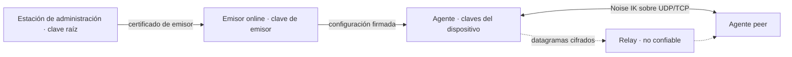

# Modelo de amenazas (MVP-0 y base del MVP)

- **Estado:** Aceptado (2026-10-24, por el responsable del proyecto). Punto de partida, no garantía.
- **Fecha:** 2026-10-24
- **Relacionados:** ADR-001…005, [configuración firmada v1](../protocol/signed-config-v1.md)

## Activos

Claves privadas de dispositivo; clave raíz y de emisor; configuraciones firmadas (autorización); confidencialidad e integridad del tráfico del túnel; disponibilidad del túnel; metadatos (quién habla con quién, cuándo, cuánto).

## Límites de confianza

El relay, la red y el coordinator se tratan como **no confiables para confidencialidad e integridad del tráfico**. La raíz y el emisor son **confiables para autorización**: su compromiso se acota en ADR-005, no se evita con E2E.

## Amenazas

| # | Amenaza | Mitigación prevista | Prueba / fase | Residual |
| --- | --- | --- | --- | --- |
| T1 | Cliente hostil (dispositivo autorizado) intenta suplantar a otro o salir de su ACL | Validación de IP origen por peer, ACL en origen y destino, denegación por defecto (contrato §3) | Fase 3: paquete con origen falso descartado | Un dispositivo autorizado puede abusar de lo que su ACL permite |
| T2 | Relay hostil lee, altera, reordena, repite o descarta paquetes | E2E con Noise IK, antirreplay y AEAD (ADR-001/003) | Fase 5: captura en el relay sin payload en claro; alteración y replay rechazados | El relay ve IPs, tamaños y tiempos; puede descartar o retrasar (denegación) |
| T3 | Coordinator comprometido anuncia endpoints falsos, desvía tráfico o espía presencia | Los endpoints son pistas no autenticadas; solo un handshake Noise IK con la clave de la configuración firmada crea una ruta. El coordinator no recibe claves; verifica la configuración firmada de cada dispositivo (sin estado) y autoriza `rendezvous` solo si es mutuo. Un mensaje 2 que no autentica no cancela el handshake pendiente. Las concesiones de relay solo se aceptan para pares configurados y se acotan y sanean antes de conectar (ver T16) | Fase 4: pruebas del coordinator; el E2E de NAT con agentes reales; agente: `forged_responses_do_not_cancel_a_pending_handshake`, `tampered_resp_fails` | Puede degradar conectividad (denegación), observar quién anuncia y cuándo, y hacer correlación de metadatos (T15) |
| T4 | Cuenta de administración robada | MFA en el proveedor OIDC (fase 3B); auditoría; la raíz no está en el host expuesto (ADR-005) | Fase 3B | Un administrador robado autoriza dispositivos hasta que se detecte; el límite es el lease |
| T5 | Servidor de control (emisor) comprometido | Certificado de emisor acotado en tiempo y serial; recuperación por la raíz (ADR-005) | Fase 3: emisor revocado por serial; fase 9: ensayo | Hasta la caducidad del certificado puede autorizar identidades maliciosas |
| T6 | Raíz comprometida o perdida | Custodia fuera de línea; dos anclas para rotar (ADR-005) | Fase 9: ensayo de reincorporación | Sin recuperación automática: reincorporar todos los dispositivos |
| T7 | Spoofing de handshake o de endpoint | Noise IK con claves conocidas; prólogo con red y versión; frescura (ADR-001); actualización de endpoint solo tras autenticar | Fase 2 | — |
| T8 | Replay y reordenación | Contador explícito, ventana de 2048 y actualización tras autenticar; sesión efímera (ADR-003) | Fase 2: propiedades y fuzzing | Código propio: revisión externa |
| T9 | Amplificación y reflexión por UDP | El respondedor solo responde a mensajes 1 válidos y autorizados; respuesta ≤ tamaño de entrada; sin respuestas a desconocidos (ADR-001). STUN propio: respuesta ≤ 2,2× la petición (44 frente a 20 bytes), límite por IP de origen compartido entre sus dos puertos y sin respuesta a lo no válido (fase 4) | Fase 4: pruebas del coordinator con sockets UDP reales (basura, límite, factor) | STUN, por diseño, responde a cualquiera: se limita por tasa; factor residual ≤ 2,2 |
| T10 | Agotamiento de CPU/memoria (inundación de mensajes 1, conexiones TCP, ClientHello lento) | Límites de tasa, tablas acotadas, plazos, cierre ante exceso (ADR-001/004). Servicios: cuotas de nonces y long-polls por dispositivo/red en coordinator; relay con cuotas IPv6 /64 y recuperación de cubos repuestos; control plane limita enrolamiento/login por IP cliente de proxy explícito y peticiones firmadas por dispositivo antes de bloquear; flujos OIDC con tope transaccional y purga, nonces acotados y auditoría de emisiones por ventana. Agente: el mensaje 1 se limita antes del DH con cupo propio por par configurado (origen conocido o relay), cupo por IP (IPv6 por /64) con tabla acotada para orígenes desconocidos y un cubo global solo para estos; las concesiones de relay no bloquean el bucle (resolución con plazo, ≤ 4 en vuelo, ≤ 4 relays) ni reaplican la red | Fases 2, 5 y 11: pruebas `device_nonce_quota_preserves_other_network`, `network_nonce_quota_preserves_other_network`, `device_poll_quota_preserves_other_network_and_cancellation`, `network_poll_quota_preserves_other_network`; control plane `ip_cliente_solo_se_toma_de_proxy_confiable`, `tope_de_flujos_oidc_es_duro_bajo_concurrencia`, `purga_flujos_y_sesiones_caducados`, `config_limitada_por_dispositivo_y_auditoria_acotada`, `dispositivo_pendiente_no_toma_el_bloqueo_de_la_red`, `estado_con_firma_invalida_no_bloquea_la_fila_del_dispositivo`; agente `spoofed_init_flood_does_not_stop_a_configured_peer`, `one_origin_cannot_exceed_its_own_quota`, `relay_destinations_are_vetted_and_bounded`; regresiones T20 | Varias redes/orígenes independientes pueden consumir capacidad global; siguen siendo necesarios límites de conexiones en el borde; un atacante con recursos suficientes puede saturar el enlace. Agente: una inundación con IP de origen suplantada agota el cubo de orígenes desconocidos (los pares configurados conservan su cupo); distinguir a un par nuevo sin ruta conocida exigiría cookie MAC1/MAC2 (cambio de protocolo, pendiente de decisión) |
| T11 | Host local multiusuario: otro usuario lee claves o controla el agente | Estado y claves 0600 con usuario de servicio; lectura sin seguir enlaces simbólicos y solo de ficheros de root o del dueño del directorio, temporales exclusivos para el estado y directorio de estado 0700; claves y semillas cargadas en memoria que se borra al soltar (`zeroize`); IPC por socket con permisos; CLI sin privilegios de red | Fase 2/7; agente: `private_reads_refuse_symbolic_links`, `state_replacement_never_follows_a_planted_temporary`, `new_state_directory_is_private` | Un root local lo controla todo; el borrado de memoria no cubre las copias de dependencias ni la semilla de `generate_seed` fuera del agente |
| T12 | Rollback de configuración o de reloj para revivir acceso | Estado persistente de versión, serial y hora máxima; fallo cerrado ante anomalía (ADR-002, contrato §3). La hora máxima solo avanza hasta el fin del lease verificado, nunca con el reloj crudo; el estado en memoria y en disco avanzan juntos antes de aplicar (un fallo posterior no lo hace retroceder); `sync` solo sustituye `config_file` con una configuración que verifica contra el estado vigente; `atenea-agent reset-clock` recupera un reloj que estuvo adelantado sin tocar versión, serial ni anclas | Fase 3; agente: `observed_time_never_passes_the_validated_lease`, `periodic_persistence_never_rolls_back_a_committed_state`, `failed_commit_keeps_the_previous_state`, `reset_clock_keeps_rollback_protection`, `unverified_body_never_replaces_the_active_config` | Un atacante con acceso al disco del agente puede borrar su estado; un reloj adelantado dentro de un lease válido puede bloquear la verificación hasta ~1 h |
| T13 | Fuga de secretos al repositorio público | `.gitignore`, escaneo de secretos de GitHub, revisión; sin inventarios ni claves | Fase 1 y CI | Falta herramienta de escaneo local propia |
| T14 | Clonación de VM o snapshot reutiliza estado de sesión (nonces) | Sesiones de vida corta y solo en memoria (ADR-003) | Fase 2: documentado, sin prueba | Riesgo aceptado; revisar con el auditor |
| T15 | Correlación de tráfico por un observador de red o del relay | No se pretende ocultarla; documentado | — | Sin protección en v1: ni relleno ni mezcla |
| T16 | Coordinator hostil dirige sondeos de un agente hacia una víctima | Solo para pares de la propia configuración firmada; ≤ 8 candidatos saneados (sin loopback, enlace local ni difusión), mensaje 1 de 114 bytes cada ~1 s durante 10 s y retardo creciente tras fallar (30 s hasta 5 min). Destinos de relay: solo para pares configurados, ≤ 4 relays por concesión, resolución con plazo y conexión a la IP verificada (sin loopback, enlace local, multicast ni redes del túnel o subredes servidas) | Fase 4: pruebas unitarias de saneado, acotación y retardo; agente `relay_destinations_are_vetted_and_bounded` | Tráfico acotado hacia terceros; el coordinator comprometido puede hacerlo |
| T17 | Repetición de un mensaje 1 desde otra IP para redirigir el tráfico del respondedor | El endpoint solo se confirma con un paquete autenticado de la sesión (y nunca dentro de la red del túnel); una repetición recibe la respuesta guardada sin cambiar estado; un mensaje 1 con marca anterior al arranque del agente no se acepta | Fase 4: `an_init_from_another_address_never_redirects_the_confirmed_endpoint`, `init_older_than_the_floor_is_not_accepted`, `roaming_never_adopts_an_endpoint_inside_the_tunnel` | Una respuesta de 62 bytes a la IP del atacante (menor que la petición de 114); la frescura del mensaje 1 sigue en memoria entre arranques, y el endpoint aprendido por itinerancia no se valida con un viaje de ida y vuelta |
| T18 | Relay usado como amplificador o reflector UDP | `COOKIE_REQ` de 64 bytes ≥ cookie de respuesta; cookie sin estado ligada a IP de origen; ALLOC solo con token firmado y prueba de posesión | Fase 5: `invalid_tokens_proofs_cookies_and_time`, fuzz `relay_parse` | Ninguno medible: la respuesta nunca supera a la petición |
| T19 | Relay reenvía a destinos arbitrarios o entre redes ajenas | Solo entre dos asignaciones emparejadas por token firmado del coordinator (mismo red, ambos dispositivos); el cliente no elige destino | Fase 5: `unpaired_unbound_and_rebinding`, E2E relay | Un coordinator comprometido puede emparejar dispositivos de su propia red; los datos siguen cifrados de extremo a extremo |
| T20 | Agotamiento del relay (asignaciones, conexiones TCP, ancho de banda) | Límites por asignación, origen (IPv4 o IPv6 /64), red y total; recuperación de cubos repuestos al llenarse la tabla; plazos de handshake y ALLOC, solo ALLOC antes de asignarse, cola TCP acotada y tramas ≤ 2048 | Fases 5/11: `full_table_evicts_refilled_buckets_under_rotation`, `ipv6_is_grouped_by_64`, `per_ip_quota_covers_the_whole_ipv6_64`, `tcp_frame_before_alloc_closes_connection` | Orígenes independientes pueden consumir la capacidad global; sin HA |
| T21 | Token de relay robado o repetido | Vida ≤ 300 s (≤ 600 aceptado), ligado a par de dispositivos y a su clave de identidad (prueba de posesión), cookie UDP por origen; TLS sin 0-RTT | Fase 5: `token_rejects_other_issuer_tampering_and_long_lifetime`; revisión de fase 11, sin cambio de formato | La prueba TCP v1 no identifica el relay receptor; vincularlo requiere una evolución de protocolo acordada. Noise sigue protegiendo los datos extremo a extremo |
| T22 | Cambio de camino malicioso (paquete forjado por otra ruta) | Un camino solo es «sano» con paquetes AUTENTICADOS por Noise; un único espacio de contadores y antirreplay compartido; histéresis de 5 s al volver a un camino mejor | Fase 5: `path_switches_to_relay_and_back_with_hysteresis`, E2E (sin `rx_auth_fail`, sin oscilación) | Un relay hostil puede descartar o retrasar tráfico (denegación), no leerlo ni alterarlo |
| T23 | Un dispositivo anuncia una ruta que no le corresponde (desvío o captura de tráfico de una subred) | Declarar no autoriza: solo las rutas **aprobadas** por un administrador y firmadas llegan a los pares; sin solapes entre rutas aprobadas ni con la red del túnel | Fase 7: pruebas del control plane (declaración, 409 por solape, aislamiento entre organizaciones), vectores v2 | Un administrador que aprueba una ruta equivocada, o un router comprometido, puede atraer el tráfico de esa subred |
| T24 | Ruta que convierte al router en salida a Internet (*exit node*) o captura la ruta por defecto | Solo prefijos privados (RFC 1918, 100.64/10, ULA), IPv4 ≥ /8 e IPv6 ≥ /32; nunca `/0`; el control plane aplica el mismo requisito a la red del túnel y no firma redes heredadas fuera de rango; CHECK aditivo `NOT VALID` y validación explícita de datos existentes (ADR-009 §7); el agente no modifica la ruta por defecto | Fase 7: vectores negativos y laboratorio; fase 11: `cidr_de_red_debe_ser_privado_y_no_demasiado_amplio` (API y restricción SQL) | No se pueden servir rangos públicos; una red heredada fuera de rango exige migración administrativa, sin reescritura automática |
| T25 | Una subred remota pisa la LAN local del cliente o su plano de control | El agente no instala rutas que se solapen con rutas no-por-defecto de otras interfaces ni que cubran endpoints de pares/coordinator/relay/control plane; informa `conflict` | Fase 7: laboratorio (LAN local solapada) y pruebas del agente | Si el endpoint no se puede resolver, las rutas de subred quedan `pending`. Los conflictos se comprueban al aplicar la configuración o cambiar endpoints, no continuamente: un cambio posterior de LAN puede solapar una ruta hasta la siguiente reaplicación |
| T26 | Un par usa al agente como tránsito para llegar a otro par o suplanta IPs de la LAN | Sin tránsito entre pares; origen válido solo en `addrs`/`routes` del par emisor; destino solo propio o `advertised`; ACL en ambos extremos | Fase 7: pruebas del engine, laboratorio (origen falsificado descartado) | La LAN no se protege de un par con ACL permisiva hacia la subred |
| T27 | Un usuario local sin privilegios controla o inspecciona el agente | Socket de control 0600 con credenciales del par; estado de solo lectura 0660 por grupo; directorio privado validado y servicio endurecido. IPC separado del bucle TUN/UDP, 16 conexiones por listener, orden ≤ 32 bytes y plazo total de 1 s; estado serializado una vez por segundo | Fase 7: laboratorio de permisos y arnés de empaquetado; fase 11: `silent_clients_do_not_stall_packets_timers_or_control` | Root local lo controla todo; el grupo de estado ve metadatos y puede ocupar las plazas de su listener, no las de control ni detener el bucle de datos |
| T28 | Estado residual tras una caída (reglas SNAT, rutas, DNS) | Las rutas desaparecen con la TUN; Linux elimina DNS por enlace. Los resolutores propios de macOS/Windows y la tabla nftables se limpian al arrancar, al parar y con `cleanup`; launchd y SCM recuperan el servicio | Fase 7: `kill -9` + `cleanup` Linux y arnés systemd; fase 11: limpieza con resolutores temporales y órdenes simuladas (sin ensayo privilegiado macOS/Windows) | macOS/Windows conservan DNS global tras una parada forzada hasta el reinicio del servicio o `cleanup`; no hay retirada instantánea al morir el proceso. Un fallo de las herramientas de limpieza es visible |
| T29 | Dependencia, acción de CI o artefacto de release comprometido o alterado antes de firmar | Acciones fijadas por SHA completo y `permissions` mínimos por job; `publish` solo desde tags `v*`, con environment protegido (revisores, solo tags, comprobado por `check-environment.py` antes de usar el secreto) y procedencia atestada y verificada por fichero y commit; `cargo deny` (advisories, licencias, fuentes), `pnpm audit --prod` y Dependabot; toolchain de CI fijado por `rust-toolchain.toml`; pnpm verificado por hash; SBOM por objetivo solo de producción, con Wintun y paquetes del `.deb`; fuzzing estructurado (`signed_config_verify`, `agent_engine`) | Fase 11: `tests/release/test_environment.py`, `tests/release/test_sbom.py`; fuzz (`fuzz/README.md`); CI y release no ejecutados contra GitHub | La clave de firma sigue siendo un secreto de GitHub (token hardware pendiente, ADR-005); PKG/ZIP sin firma nativa; se confía en GitHub Actions y en el servicio de atestaciones; una advisory sin parche solo se detecta, no se evita |

**DNS dividido (ADR-007 §5):** los dominios de enrutamiento son una decisión administrativa de la red. Aprobar un dominio público hace que sus consultas se dirijan al DNS del túnel; no se impone una lista fija de sufijos porque también se admiten dominios propios del operador. Es un riesgo residual aceptable pendiente de decidir si se añade un aviso en el panel o una lista de permitidos configurable por red, sin cambiar ahora la configuración firmada.

## Fuera de alcance

Ataques físicos al dispositivo; compromiso del núcleo del SO; canales laterales de hardware; criptografía postcuántica (sin PSK en v1); anonimato frente al relay; inspección TLS corporativa que impida el fallback TCP 443.

## Supuestos

- NTP razonable en los dispositivos (ADR-002); un reloj fuera de tolerancia deniega.
- Las claves privadas de dispositivo no salen del dispositivo.
- El relay y el coordinator no reciben claves de peers distintas de las públicas.
- No hay auditoría independiente del protocolo: este modelo es un punto de partida, no una garantía (fase 11).
