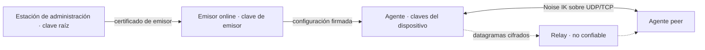

# Modelo de amenazas (MVP-0 y base del MVP)

- **Estado:** Aceptado (2026-10-24, por el responsable del proyecto). Punto de partida, no garantía.
- **Fecha:** 2026-10-24
- **Relacionados:** ADR-001…005, [configuración firmada v1](../protocol/signed-config-v1.md)

## Activos

Claves privadas de dispositivo; clave raíz y de emisor; configuraciones firmadas (autorización); confidencialidad e integridad del tráfico del túnel; disponibilidad del túnel; metadatos (quién habla con quién, cuándo, cuánto).

## Límites de confianza

El relay, la red y el coordinator se tratan como **no confiables para confidencialidad e integridad del tráfico**. La raíz y el emisor son **confiables para autorización**: su compromiso se acota en ADR-005, no se evita con E2E.

## Amenazas

| # | Amenaza | Mitigación prevista | Prueba / fase | Residual |
| --- | --- | --- | --- | --- |
| T1 | Cliente hostil (dispositivo autorizado) intenta suplantar a otro o salir de su ACL | Validación de IP origen por peer, ACL en origen y destino, denegación por defecto (contrato §3); bidireccionalidad efectiva advertida en el panel y el contrato del control plane | Fase 3: paquete con origen falso descartado | Un dispositivo autorizado puede usar todo lo que su ACL permite, incluida la regla inversa sin puertos (F6); riesgo aceptado y condición de salida descritos debajo |
| T2 | Relay hostil lee, altera, reordena, repite o descarta paquetes | E2E con Noise IK, antirreplay y AEAD (ADR-001/003) | Fase 5: captura en el relay sin payload en claro; alteración y replay rechazados | El relay ve IPs, tamaños y tiempos; puede descartar o retrasar (denegación) |
| T3 | Coordinator comprometido anuncia endpoints falsos, desvía tráfico o espía presencia | Los endpoints son pistas no autenticadas; solo un handshake Noise IK con la clave de la configuración firmada crea una ruta. El coordinator no recibe claves; verifica la configuración firmada de cada dispositivo (sin estado) y autoriza `rendezvous` solo si es mutuo. Un mensaje 2 que no autentica no cancela el handshake pendiente. Las concesiones de relay solo se aceptan para pares configurados y se acotan y sanean antes de conectar (ver T16) | Fase 4: pruebas del coordinator; el E2E de NAT con agentes reales; agente: `forged_responses_do_not_cancel_a_pending_handshake`, `tampered_resp_fails` | Puede degradar conectividad (denegación), observar quién anuncia y cuándo, y hacer correlación de metadatos (T15) |
| T4 | Cuenta de administración robada | MFA en el proveedor OIDC (fase 3B); auditoría; la raíz no está en el host expuesto (ADR-005) | Fase 3B | Un administrador robado autoriza dispositivos hasta que se detecte; el límite es el lease |
| T5 | Servidor de control (emisor) comprometido | Certificado de emisor acotado en tiempo y serial; recuperación por la raíz (ADR-005) | Fase 3: emisor revocado por serial; fase 9: ensayo | Hasta la caducidad del certificado puede autorizar identidades maliciosas |
| T6 | Raíz comprometida o perdida | Custodia fuera de línea; dos anclas para rotar (ADR-005) | Fase 9: ensayo de reincorporación | Sin recuperación automática: reincorporar todos los dispositivos |
| T7 | Spoofing de handshake o de endpoint | Noise IK con claves conocidas; prólogo con red y versión; frescura (ADR-001); actualización de endpoint solo tras autenticar | Fase 2 | — |
| T8 | Replay y reordenación | Contador explícito, ventana de 2048 y actualización tras autenticar; sesión efímera (ADR-003) | Fase 2: propiedades y fuzzing | Código propio: revisión externa |
| T9 | Amplificación y reflexión por UDP | Wire-v2: RESP solo tras Noise autorizado; COOKIE_REPLY solo tras MAC1 correcto y bajo carga, con cuotas separadas; ambas respuestas de 62 bytes ≤ INIT de 146. STUN propio conserva factor ≤2,2 (44/20), cuota por IP compartida entre puertos y silencio ante basura | Exigido para v2: tamaños, límites y silencio ante MAC1/versión inválidos (wire-v2 §7); pruebas históricas STUN de fase 4 no verifican v2 | MAC1 no autentica: su clave es derivable de la pública; puede haber cookie antes de conocer la identidad. STUN responde a cualquiera bajo cuota |
| T10 | Agotamiento de CPU/memoria (mensajes 1, conexiones TCP, ClientHello lento) | Motor wire-v2: versión/tamaño→MAC1→contador monotónico (umbral positivo, defecto100/s)→bajo carga MAC2/cookie→cupos por origen→DH. MAC1 inválido no toca estado por origen; desafío sin DH ni consumir cupos DH de desconocidos. Respuestas separadas: 20/s y ráfaga20 por IP (IPv6 /64) o contexto relay/par, 100/s y ráfaga100 global, tabla≤4096 con recuperación de cubos repuestos. Se conservan límites DH por par/IP IPv6 /64 y tablas acotadas, resolución relay con plazo/≤4 concesiones. Servicios: cuotas por dispositivo/red de nonces/long-polls; límites de relay T20, enrolamiento/login, flujos OIDC con tope/purga y auditoría por ventana | Cobertura añadida, no ejecutada en esta actualización: motor `invalid_mac1_never_spends_dh_or_origin_state`, `cookie_threshold_and_monotonic_window_boundary`, `cookie_challenge_flood_preserves_unknown_dh_budget`, `cookie_reply_quotas_and_bounded_table_recover`; crypto `validation_order_load_threshold_and_window_boundary`. Se conservan regresiones de aislamiento de coordinator/control plane, `spoofed_init_flood_does_not_stop_a_configured_peer`, `one_origin_cannot_exceed_its_own_quota`, `relay_destinations_are_vetted_and_bounded` | MAC1 es público, no identidad; la primera ventana admite hasta el umbral sin cookie y bajo carga el retorno de cookie no exime de cuotas ni autorización Noise. Riesgo aceptado: no evita saturación de enlace ni agotamiento por fuentes que reciben cookies; umbral y cupos requieren medición operativa |
| T11 | Host local multiusuario: otro usuario lee claves o controla el agente | Estado y claves 0600 con usuario de servicio; lectura sin seguir enlaces simbólicos y solo de ficheros de root o del dueño del directorio, temporales exclusivos para el estado y directorio de estado 0700; claves y semillas cargadas en memoria que se borra al soltar (`zeroize`); IPC por socket con permisos; CLI sin privilegios de red | Fase 2/7; agente: `private_reads_refuse_symbolic_links`, `state_replacement_never_follows_a_planted_temporary`, `new_state_directory_is_private` | Un root local lo controla todo; el borrado de memoria no cubre las copias de dependencias ni la semilla de `generate_seed` fuera del agente |
| T12 | Rollback de configuración o de reloj para revivir acceso | Estado persistente de versión, serial y hora máxima; fallo cerrado ante anomalía (ADR-002, contrato §3). La hora máxima solo avanza hasta el fin del lease verificado, nunca con el reloj crudo; el estado en memoria y en disco avanzan juntos antes de aplicar (un fallo posterior no lo hace retroceder); `sync` solo sustituye `config_file` con una configuración que verifica contra el estado vigente; `atenea-agent reset-clock` recupera un reloj que estuvo adelantado sin tocar versión, serial ni anclas | Fase 3; agente: `observed_time_never_passes_the_validated_lease`, `periodic_persistence_never_rolls_back_a_committed_state`, `failed_commit_keeps_the_previous_state`, `reset_clock_keeps_rollback_protection`, `unverified_body_never_replaces_the_active_config` | Un atacante con acceso al disco del agente puede borrar su estado; un reloj adelantado dentro de un lease válido puede bloquear la verificación hasta ~1 h |
| T13 | Fuga de secretos al repositorio público | `.gitignore`, escaneo de secretos de GitHub, revisión; sin inventarios ni claves | Fase 1 y CI | Falta herramienta de escaneo local propia |
| T14 | Clonación de VM o snapshot reutiliza estado de sesión (nonces) | Sesiones de vida corta y solo en memoria (ADR-003) | Fase 2: documentado, sin prueba | Riesgo aceptado; revisar con el auditor |
| T15 | Correlación de tráfico por un observador de red o del relay | No se pretende ocultarla; documentado | — | Wire-v2 tampoco añade relleno ni mezcla; cookies y relay_id no ocultan metadatos |
| T16 | Coordinator hostil dirige sondeos de un agente hacia una víctima | Solo pares de configuración firmada; ≤8 candidatos saneados, INIT v2 de146 bytes con sondeo ~1s, ventana≤10s y ≤12 envíos por candidato, incluidos reintentos de cookie, y backoff30..300s. Cookie reenvía el mismo INIT/índice/Noise únicamente por una ruta ya sondeada, como máximo una vez por ronda y candidato; no reinicia ventana ni backoff. Relay: ≤4 destinos, resolución con plazo y conexión a IP verificada, sin loopback/link-local/multicast/redes del túnel o subredes servidas | Cobertura añadida, no ejecutada en esta actualización: `cookie_retries_obey_candidate_send_and_attempt_budgets`, `cookie_retry_preserves_init_route_and_unhealthy_state`; se conservan saneado, `repeated_candidates_do_not_extend_a_pending_probe` y `relay_destinations_are_vetted_and_bounded` | Riesgo aceptado: un coordinator comprometido puede provocar tráfico acotado hacia terceros; una cookie, incluso descifrable, no autentica al destinatario ni confirma endpoint/salud |
| T17 | Repetición de un mensaje 1 desde otra IP para redirigir el tráfico del respondedor | El endpoint solo se confirma con un paquete autenticado de la sesión (y nunca dentro de la red del túnel); una repetición recibe la respuesta guardada sin cambiar estado; un mensaje 1 con marca anterior al arranque del agente no se acepta | Fase 4: `an_init_from_another_address_never_redirects_the_confirmed_endpoint`, `init_older_than_the_floor_is_not_accepted`, `roaming_never_adopts_an_endpoint_inside_the_tunnel` | Una respuesta de 62 bytes (menor que la petición de 146); la frescura del mensaje 1 sigue en memoria entre arranques. Se acepta el roaming sin validación de retorno del endpoint, comportamiento tipo WireGuard (F7; ver nota debajo) |
| T18 | Relay usado como amplificador o reflector UDP | Relay-v2: COOKIE_REQ64 ≥ COOKIE35; cookie ligada a IP/puerto/relay_id y ventana temporal; ALLOC298 solo con token y prueba del dispositivo; errores solo tras cookie válida | Exigido: cookie de otro origen/ID/caducada, sin amplificación y fuzz `relay_parse`; conservar regresiones de fase5 | Cuotas limitan tráfico, no garantizan disponibilidad; versión UDP desconocida no recibe respuesta |
| T19 | Relay reenvía a destinos arbitrarios o entre redes ajenas | Solo entre dos asignaciones emparejadas por token firmado del coordinator (mismo red, ambos dispositivos); el cliente no elige destino | Fase 5: `unpaired_unbound_and_rebinding`, E2E relay | Un coordinator comprometido puede emparejar dispositivos de su propia red; los datos siguen cifrados de extremo a extremo |
| T20 | Agotamiento del relay (asignaciones, conexiones TCP, ancho de banda) | Límites por asignación, origen IPv4/IPv6 /64, red y total; recuperación de cubos repuestos; plazos TLS/ALLOC; cola TCP acotada, tramas≤2048; antes de asignarse solo ALLOC. Relay-v2 comprueba audiencia local antes de firmas/asignación; tokens por relay y ≤4 destinos por concesión | Conservar `full_table_evicts_refilled_buckets_under_rotation`, `ipv6_is_grouped_by_64`, `per_ip_quota_covers_the_whole_ipv6_64`, `tcp_frame_before_alloc_closes_connection`; exigir rechazo WrongRelay sin crear/refrescar estado y cuotas para 2R tokens | Fuentes independientes pueden consumir capacidad global; sin HA; audiencia no sustituye límites ni evita replay dentro del mismo relay |
| T21 | Token de relay presentado fuera de su audiencia o repetido | Relay-v2 token189 firma relay_id16; ALLOC firma explícitamente el mismo ID y relay exige igualdad con su configuración. Vida emitida300 s (máximo600), tolerancia30 s, prueba ts±30 s, clave de identidad, cookie UDP por origen/relay; TLS sin0-RTT. Cutover sin v1 | Exigido: dos relays con misma clave de coordinator e IDs diferentes, token/prueba de A rechazados por B con WrongRelay9, mutaciones de ID/firma/token, UDP y TCP, rechazo v1; pruebas/vectores de relay-v2 §8–9 | No evita retransmisiones ALLOC en la misma audiencia dentro de frescura; IDs duplicados comparten audiencia y deben evitarse operativamente. Noise sigue protegiendo datos. Especificado, no implementado/verificado |
| T22 | Cambio de camino malicioso (paquete forjado por otra ruta) | Un camino solo es «sano» con paquetes AUTENTICADOS por Noise; un único espacio de contadores y antirreplay compartido; histéresis de 5 s al volver a un camino mejor | Fase 5: `path_switches_to_relay_and_back_with_hysteresis`, E2E (sin `rx_auth_fail`, sin oscilación) | Un relay hostil puede descartar o retrasar tráfico (denegación), no leerlo ni alterarlo |
| T23 | Un dispositivo anuncia una ruta que no le corresponde (desvío o captura de tráfico de una subred) | Declarar no autoriza: solo las rutas **aprobadas** por un administrador y firmadas llegan a los pares; sin solapes entre rutas aprobadas ni con la red del túnel | Fase 7: pruebas del control plane (declaración, 409 por solape, aislamiento entre organizaciones), vectores v2 | Un administrador que aprueba una ruta equivocada, o un router comprometido, puede atraer el tráfico de esa subred |
| T24 | Ruta que convierte al router en salida a Internet (*exit node*) o captura la ruta por defecto | Solo prefijos privados (RFC 1918, 100.64/10, ULA), IPv4 ≥ /8 e IPv6 ≥ /32; nunca `/0`; el control plane aplica el mismo requisito a la red del túnel y no firma redes heredadas fuera de rango; CHECK aditivo `NOT VALID` y validación explícita de datos existentes (ADR-009 §7); el agente no modifica la ruta por defecto | Fase 7: vectores negativos y laboratorio; fase 11: `cidr_de_red_debe_ser_privado_y_no_demasiado_amplio` (API y restricción SQL) | No se pueden servir rangos públicos; una red heredada fuera de rango exige migración administrativa, sin reescritura automática |
| T25 | Una subred remota pisa la LAN local del cliente o su plano de control | El agente no instala rutas que se solapen con rutas no-por-defecto de otras interfaces ni que cubran endpoints de pares/coordinator/relay/control plane; informa `conflict` | Fase 7: laboratorio (LAN local solapada) y pruebas del agente | Si el endpoint no se puede resolver, las rutas de subred quedan `pending`. Los conflictos se comprueban al aplicar la configuración o cambiar endpoints, no continuamente: un cambio posterior de LAN puede solapar una ruta hasta la siguiente reaplicación |
| T26 | Un par usa al agente como tránsito para llegar a otro par o suplanta IPs de la LAN | Sin tránsito entre pares; origen válido solo en `addrs`/`routes` del par emisor; destino solo propio o `advertised`; ACL en ambos extremos | Fase 7: pruebas del engine, laboratorio (origen falsificado descartado) | La LAN no se protege de un par con ACL permisiva hacia la subred; la regla inversa sin puertos también autoriza iniciar tráfico en sentido inverso (F6; ver condición de salida debajo) |
| T27 | Un usuario local sin privilegios controla o inspecciona el agente | Socket de control 0600 con credenciales del par; estado de solo lectura 0660 por grupo; directorio privado validado y servicio endurecido. IPC separado del bucle TUN/UDP, 16 conexiones por listener, orden ≤ 32 bytes y plazo total de 1 s; estado serializado una vez por segundo | Fase 7: laboratorio de permisos y arnés de empaquetado; fase 11: `silent_clients_do_not_stall_packets_timers_or_control` | Root local lo controla todo; el grupo de estado ve metadatos y puede ocupar las plazas de su listener, no las de control ni detener el bucle de datos |
| T28 | Estado residual tras una caída (reglas SNAT, rutas, DNS) | Las rutas desaparecen con la TUN; Linux elimina DNS por enlace. Los resolutores propios de macOS/Windows y la tabla nftables se limpian al arrancar, al parar y con `cleanup`; launchd y SCM recuperan el servicio | Fase 7: `kill -9` + `cleanup` Linux y arnés systemd; fase 11: limpieza con resolutores temporales y órdenes simuladas (sin ensayo privilegiado macOS/Windows) | macOS/Windows conservan DNS global tras una parada forzada hasta el reinicio del servicio o `cleanup`; no hay retirada instantánea al morir el proceso. Un fallo de las herramientas de limpieza es visible |
| T29 | Dependencia, acción de CI o artefacto de release comprometido o alterado antes de firmar | Acciones fijadas por SHA completo y `permissions` mínimos por job; `publish` solo desde tags `v*`, con environment protegido (revisores, solo tags, comprobado por `check-environment.py` antes de usar el secreto) y procedencia atestada y verificada por fichero y commit; `cargo deny` (advisories, licencias, fuentes), `pnpm audit --prod` y Dependabot; toolchain de CI fijado por `rust-toolchain.toml`; pnpm verificado por hash; SBOM por objetivo solo de producción, con Wintun y paquetes del `.deb`; fuzzing estructurado (`signed_config_verify`, `agent_engine`) | Fase 11: `tests/release/test_environment.py`, `tests/release/test_sbom.py`; fuzz (`fuzz/README.md`); CI y release no ejecutados contra GitHub | La clave de firma sigue siendo un secreto de GitHub (token hardware pendiente, ADR-005); PKG/ZIP sin firma nativa; se confía en GitHub Actions y en el servicio de atestaciones; una advisory sin parche solo se detecta, no se evita |
| T30 | Confundir cookie anti-DoS con autenticación o reutilizarla entre contextos | Motor/crypto wire-v2: cookie ligada a IP+puerto (IPv4-mapped normalizada) o relay_id+red+emisor+receptor del contexto local/Rx; UDP/TLS del mismo relay/par comparten origen. Respuesta XChaCha20Poly1305 con nonce aleatorio192, clave derivada de pública+MAC1 y AAD cabecera+MAC1. Secretos efímeros rotan cada120s monotónicos; solo anterior, descartado al saltar dos períodos; reinicio invalida cookies. Fallo RNG descarta y se contabiliza. Caché≤120s por estática/ruta, borrada al cambiar configuración o lease; respuesta solo para intento pendiente y ruta ya enviada. No crea sesión ni confirma endpoint/salud; errores no cancelan intento ni borran caché | Cobertura añadida, no ejecutada en esta actualización: motor `malicious_cookie_replies_do_not_cancel_pending_or_clear_cache`, `cookie_retry_preserves_init_route_and_unhealthy_state`, `candidate_cookies_are_isolated_and_nat_rebind_is_challenged`, `engine_cookie_rotation_accepts_previous_then_expires_it`, `relay_cookie_is_bound_to_id_direction_and_pending_transport`; crypto `independent_vectors_1_to_4`, `every_cookie_reply_byte_and_context_is_authenticated`, `canonical_sources_and_context_isolation`, `rotation_boundaries_previous_expiry_and_skipped_periods`, `cache_never_shares_key_route_or_extends_ttl`, `rng_failure_never_emits_or_advances_rotation` | Riesgos aceptados: MAC1 y clave de respuesta son públicos, permiten interferencia de disponibilidad; solo Noise y configuración autentican/autorizan. Un relay puede manipular atribución de origen sin obtener identidad Noise ni prueba E2E de retorno IP. Cookies solo protegen INIT; roaming de sesiones establecidas conserva actualización por datos autenticados sin desafío de retorno adicional (F7) |

**DNS dividido (ADR-007 §5):** los dominios de enrutamiento son una decisión administrativa de la red. Aprobar un dominio público hace que sus consultas se dirijan al DNS del túnel; no se impone una lista fija de sufijos porque también se admiten dominios propios del operador. Es un riesgo residual aceptable pendiente de decidir si se añade un aviso en el panel o una lista de permitidos configurable por red, sin cambiar ahora la configuración firmada.

**ACL sin estado y bidireccionalidad efectiva (F6, T1/T26; decisión aceptada el 2026-10-25).** El control plane emite una regla inversa con los selectores intercambiados, el mismo protocolo y sin restricción de puertos. Una política A→B `tcp/22` permite también a B iniciar tráfico TCP a A en cualquier puerto: no es solo autorización del retorno de una conexión de A. Se mantiene esta semántica y se hace explícita en la documentación y el panel; se acepta el alcance adicional también para selectores de subred. **Mejora futura y condición de salida:** implantar ACL con seguimiento de conexiones en el agente, retirar la regla inversa general del control plane y verificar que el retorno de conexiones autorizadas funciona mientras las conexiones nuevas en sentido inverso se deniegan salvo política explícita. Hasta ese cambio coordinado y sus pruebas, no se ofrece aislamiento unidireccional.

**Roaming sin validación de retorno (F7, T17; riesgo residual aceptado el 2026-10-25).** Un paquete autenticado y aceptado por la sesión permite adoptar su endpoint de origen sin comprobar antes un viaje de ida y vuelta a ese endpoint, comportamiento tipo WireGuard. La autenticidad del paquete no prueba por sí sola que el par pueda recibir en esa dirección. Se acepta este límite para conservar la itinerancia; la mitigación parcial ya aplicada impide adoptar endpoints dentro de la red del túnel, pero no sustituye una validación de retorno.

## Fuera de alcance

Ataques físicos al dispositivo; compromiso del núcleo del SO; canales laterales de hardware; criptografía postcuántica (sin PSK en v1); anonimato frente al relay; inspección TLS corporativa que impida el fallback TCP 443.

## Supuestos

- NTP razonable en los dispositivos (ADR-002); un reloj fuera de tolerancia deniega.
- Las claves privadas de dispositivo no salen del dispositivo.
- El relay y el coordinator no reciben claves de peers distintas de las públicas.
- No hay auditoría independiente del protocolo: este modelo es un punto de partida, no una garantía (fase 11).

## Riesgos aceptados temporalmente (dependencias)

### DEP-2026-01 — crypto-bigint 0.5.5 / RUSTSEC-2026-0387

- **Estado:** excepción temporal autorizada el 2026-10-25; revisar **antes de
  2027-01-23**. Propietario: responsable de seguridad de Atenea One.
- **Motivo:** [el advisory](https://rustsec.org/advisories/RUSTSEC-2026-0387)
  describe variabilidad temporal al operar con enteros secretos. El grafo de
  producción solo llega por `openidconnect` → `p256`/`p384` → `elliptic-curve`.
  `apps/control-plane/src/auth.rs::callback` verifica ID tokens: operaciones
  afectadas solo sobre enteros públicos (verificación); sin secretos ECDSA en el
  proceso. No se usa esta cadena para firmar, generar claves ni hacer DH.
- **Condición de salida:** openidconnect estable con p256/p384 0.14 y
  crypto-bigint ≥ 0.7.6 resuelto; retirar la excepción de `deny.toml`. La versión
  estable actual de openidconnect (4.0.1) exige todavía las curvas 0.13.
- **Invalidación anticipada:** introducir claves privadas ECDSA o DH mediante
  estos crates exige retirar esta aceptación y revisar la exposición.

### DEP-2026-02 — rsa 0.9.10 / RUSTSEC-2023-0071

- **Estado:** excepción temporal autorizada el 2026-10-25; revisar **antes de
  2027-01-23**. Propietario: responsable de seguridad de Atenea One.
- **Motivo:** [el advisory](https://rustsec.org/advisories/RUSTSEC-2023-0071)
  afecta a operaciones con clave privada RSA. En producción el mismo callback
  solo verifica ID tokens con la clave pública RSA del IdP, mediante
  `openidconnect::core::crypto::verify_rsa_signature` (`RsaPublicKey::verify`).
  La clave privada de `apps/control-plane/tests/oidc.rs` es efímera y exclusiva
  del IdP de pruebas; no forma parte del servicio desplegado.
- **Condición de salida:** versión corregida de rsa compatible con openidconnect
  o retirada upstream de la dependencia; eliminar la excepción tras actualizar.
  Actualmente upstream no publica una versión corregida.
- **Invalidación anticipada:** cualquier firma o descifrado con clave privada RSA
  en producción exige retirar esta aceptación y revisar la exposición.

Estas excepciones se limitan a esos dos IDs; el resto de advisories y las
restricciones de licencias y fuentes siguen activas. Análisis de compatibilidad:
`docs/architecture/dependencies.md`, sección de excepciones temporales.

