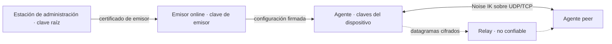

# Modelo de amenazas (MVP-0 y base del MVP)

- **Estado:** Aceptado (2026-10-24, por el responsable del proyecto). Punto de partida, no garantía.
- **Fecha:** 2026-10-24
- **Relacionados:** ADR-001…005, [configuración firmada v1](../protocol/signed-config-v1.md)

## Activos

Claves privadas de dispositivo; clave raíz y de emisor; configuraciones firmadas (autorización); confidencialidad e integridad del tráfico del túnel; disponibilidad del túnel; metadatos (quién habla con quién, cuándo, cuánto).

## Límites de confianza

El relay, la red y el coordinator se tratan como **no confiables para confidencialidad e integridad del tráfico**. La raíz y el emisor son **confiables para autorización**: su compromiso se acota en ADR-005, no se evita con E2E.

## Amenazas

| # | Amenaza | Mitigación prevista | Prueba / fase | Residual |
| --- | --- | --- | --- | --- |
| T1 | Cliente hostil (dispositivo autorizado) intenta suplantar a otro o salir de su ACL | Validación de IP origen por peer, ACL en origen y destino, denegación por defecto (contrato §3) | Fase 3: paquete con origen falso descartado | Un dispositivo autorizado puede abusar de lo que su ACL permite |
| T2 | Relay hostil lee, altera, reordena, repite o descarta paquetes | E2E con Noise IK, antirreplay y AEAD (ADR-001/003) | Fase 5: captura en el relay sin payload en claro; alteración y replay rechazados | El relay ve IPs, tamaños y tiempos; puede descartar o retrasar (denegación) |
| T3 | Coordinator comprometido anuncia endpoints falsos, desvía tráfico o espía presencia | Los endpoints son pistas no autenticadas; solo un handshake Noise IK con la clave de la configuración firmada crea una ruta. El coordinator no recibe claves; verifica la configuración firmada de cada dispositivo (sin estado) y autoriza `rendezvous` solo si es mutuo | Fase 4: pruebas del coordinator; el E2E de NAT con agentes reales | Puede degradar conectividad (denegación), observar quién anuncia y cuándo, y hacer correlación de metadatos (T15) |
| T4 | Cuenta de administración robada | MFA en el proveedor OIDC (fase 3B); auditoría; la raíz no está en el host expuesto (ADR-005) | Fase 3B | Un administrador robado autoriza dispositivos hasta que se detecte; el límite es el lease |
| T5 | Servidor de control (emisor) comprometido | Certificado de emisor acotado en tiempo y serial; recuperación por la raíz (ADR-005) | Fase 3: emisor revocado por serial; fase 9: ensayo | Hasta la caducidad del certificado puede autorizar identidades maliciosas |
| T6 | Raíz comprometida o perdida | Custodia fuera de línea; dos anclas para rotar (ADR-005) | Fase 9: ensayo de reincorporación | Sin recuperación automática: reincorporar todos los dispositivos |
| T7 | Spoofing de handshake o de endpoint | Noise IK con claves conocidas; prólogo con red y versión; frescura (ADR-001); actualización de endpoint solo tras autenticar | Fase 2 | — |
| T8 | Replay y reordenación | Contador explícito, ventana de 2048 y actualización tras autenticar; sesión efímera (ADR-003) | Fase 2: propiedades y fuzzing | Código propio: revisión externa |
| T9 | Amplificación y reflexión por UDP | El respondedor solo responde a mensajes 1 válidos y autorizados; respuesta ≤ tamaño de entrada; sin respuestas a desconocidos (ADR-001). STUN propio: respuesta ≤ 2,2× la petición (44 frente a 20 bytes), límite por IP de origen compartido entre sus dos puertos y sin respuesta a lo no válido (fase 4) | Fase 4: pruebas del coordinator con sockets UDP reales (basura, límite, factor) | STUN, por diseño, responde a cualquiera: se limita por tasa; factor residual ≤ 2,2 |
| T10 | Agotamiento de CPU/memoria (inundación de mensajes 1, conexiones TCP, ClientHello lento) | Límites de tasa, tablas acotadas, plazos, cierre ante exceso (ADR-001/004) | Fases 2, 5 y 11: pruebas de abuso y carga | Un atacante con recursos suficientes puede saturar el enlace |
| T11 | Host local multiusuario: otro usuario lee claves o controla el agente | Estado y claves 0600 con usuario de servicio; IPC por socket con permisos; CLI sin privilegios de red | Fase 2/7 | Un root local lo controla todo |
| T12 | Rollback de configuración o de reloj para revivir acceso | Estado persistente de versión, serial y hora máxima; fallo cerrado ante anomalía (ADR-002, contrato §3) | Fase 3 | Un atacante con acceso al disco del agente puede borrar su estado |
| T13 | Fuga de secretos al repositorio público | `.gitignore`, escaneo de secretos de GitHub, revisión; sin inventarios ni claves | Fase 1 y CI | Falta herramienta de escaneo local propia |
| T14 | Clonación de VM o snapshot reutiliza estado de sesión (nonces) | Sesiones de vida corta y solo en memoria (ADR-003) | Fase 2: documentado, sin prueba | Riesgo aceptado; revisar con el auditor |
| T15 | Correlación de tráfico por un observador de red o del relay | No se pretende ocultarla; documentado | — | Sin protección en v1: ni relleno ni mezcla |
| T16 | Coordinator hostil dirige sondeos de un agente hacia una víctima | Solo para pares de la propia configuración firmada; ≤ 8 candidatos saneados (sin loopback, enlace local ni difusión), mensaje 1 de 118 bytes cada ~1 s durante 10 s y retardo creciente tras fallar (30 s hasta 5 min) | Fase 4: pruebas unitarias de saneado, acotación y retardo | Tráfico acotado hacia terceros; el coordinator comprometido puede hacerlo |
| T17 | Repetición de un mensaje 1 desde otra IP para redirigir el tráfico del respondedor | El endpoint solo se confirma con un paquete autenticado de la sesión; una repetición recibe la respuesta guardada sin cambiar estado | Fase 4: `an_init_from_another_address_never_redirects_the_confirmed_endpoint` | Una respuesta de 62 bytes a la IP del atacante (menor que la petición de 118) |
| T18 | Relay usado como amplificador o reflector UDP | `COOKIE_REQ` de 64 bytes ≥ cookie de respuesta; cookie sin estado ligada a IP de origen; ALLOC solo con token firmado y prueba de posesión | Fase 5: `invalid_tokens_proofs_cookies_and_time`, fuzz `relay_parse` | Ninguno medible: la respuesta nunca supera a la petición |
| T19 | Relay reenvía a destinos arbitrarios o entre redes ajenas | Solo entre dos asignaciones emparejadas por token firmado del coordinator (mismo red, ambos dispositivos); el cliente no elige destino | Fase 5: `unpaired_unbound_and_rebinding`, E2E relay | Un coordinator comprometido puede emparejar dispositivos de su propia red; los datos siguen cifrados de extremo a extremo |
| T20 | Agotamiento del relay (asignaciones, conexiones TCP, ancho de banda) | Límites por asignación, IP, red y total; cubos de paquetes/bits; plazos de handshake y ALLOC; cola TCP acotada; tramas ≤ 2048 | Fase 5: pruebas de límites con reloj inyectado | Un atacante con tokens válidos consume su cuota; sin HA |
| T21 | Token de relay robado o repetido | Vida ≤ 300 s (≤ 600 aceptado), ligado a par de dispositivos y a su clave de identidad (prueba de posesión), cookie por origen | Fase 5: `token_rejects_other_issuer_tampering_and_long_lifetime` | Un token robado sin la clave de identidad no sirve |
| T22 | Cambio de camino malicioso (paquete forjado por otra ruta) | Un camino solo es «sano» con paquetes AUTENTICADOS por Noise; un único espacio de contadores y antirreplay compartido; histéresis de 5 s al volver a un camino mejor | Fase 5: `path_switches_to_relay_and_back_with_hysteresis`, E2E (sin `rx_auth_fail`, sin oscilación) | Un relay hostil puede descartar o retrasar tráfico (denegación), no leerlo ni alterarlo |
| T23 | Un dispositivo anuncia una ruta que no le corresponde (desvío o captura de tráfico de una subred) | Declarar no autoriza: solo las rutas **aprobadas** por un administrador y firmadas llegan a los pares; sin solapes entre rutas aprobadas ni con la red del túnel | Fase 7: pruebas del control plane (declaración, 409 por solape, aislamiento entre organizaciones), vectores v2 | Un administrador que aprueba una ruta equivocada, o un router comprometido, puede atraer el tráfico de esa subred |
| T24 | Ruta que convierte al router en salida a Internet (*exit node*) o captura la ruta por defecto | Solo prefijos privados (RFC 1918, 100.64/10, ULA) con longitud mínima; nunca `/0`; el agente no modifica la ruta por defecto | Fase 7: vectores negativos (/0, públicos, cortos); laboratorio (ruta por defecto idéntica) | No se pueden servir rangos públicos |
| T25 | Una subred remota pisa la LAN local del cliente o su plano de control | El agente no instala rutas que se solapen con rutas no-por-defecto de otras interfaces ni que cubran endpoints de pares/coordinator/relay/control plane; informa `conflict` | Fase 7: laboratorio (LAN local solapada) y pruebas del agente | Si el endpoint no se puede resolver, las rutas de subred quedan `pending` (no se instalan) |
| T26 | Un par usa al agente como tránsito para llegar a otro par o suplanta IPs de la LAN | Sin tránsito entre pares; origen válido solo en `addrs`/`routes` del par emisor; destino solo propio o `advertised`; ACL en ambos extremos | Fase 7: pruebas del engine, laboratorio (origen falsificado descartado) | La LAN no se protege de un par con ACL permisiva hacia la subred |
| T27 | Un usuario local sin privilegios controla o inspecciona el agente | Socket de control 0600 con `SO_PEERCRED`; socket de estado de solo lectura 0660 por grupo; servicio endurecido (`systemd-analyze security` 4.0) | Fase 7: laboratorio (usuario ajeno no puede parar ni leer; grupo solo lee) y arnés de empaquetado | Root local lo controla todo; el grupo con acceso al estado ve metadatos de la red |
| T28 | Estado residual tras una caída (reglas SNAT, rutas, DNS) | Rutas y DNS por enlace desaparecen con la TUN; la tabla nftables propia se borra al arrancar, al parar y con `cleanup` (`ExecStopPost`) | Fase 7: `kill -9` + `cleanup` en laboratorio y arnés systemd | Tras un fallo del propio `nft` el borrado es un error visible, no silencioso |

## Fuera de alcance

Ataques físicos al dispositivo; compromiso del núcleo del SO; canales laterales de hardware; criptografía postcuántica (sin PSK en v1); anonimato frente al relay; inspección TLS corporativa que impida el fallback TCP 443.

## Supuestos

- NTP razonable en los dispositivos (ADR-002); un reloj fuera de tolerancia deniega.
- Las claves privadas de dispositivo no salen del dispositivo.
- El relay y el coordinator no reciben claves de peers distintas de las públicas.
- No hay auditoría independiente del protocolo: este modelo es un punto de partida, no una garantía (fase 11).
